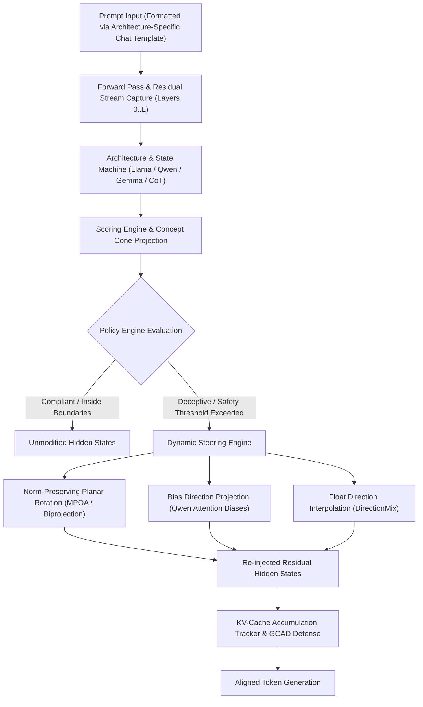

# BurnNotice

> Real-Time Latent Governance, Alignment Monitoring, and Dynamic Activation Steering for Autonomous LLM Agents.

---

BurnNotice is a high-performance, low-latency agent governance framework designed to detect, monitor, and dynamically steer autonomous language model agents at the **latent activation level**.

By interfacing directly with the model's inner representations, BurnNotice bypasses vulnerable, high-latency classifier wrapper loops. It monitors internal activation vectors in real-time, matches them against declarative safety policies, and performs norm-preserving angular rotations in the activation space to steer agents back into alignment before a single rogue token is ever generated.

---

## Key Features

* **Multi-Family Architecture Compatibility**: Native support for Meta Llama (Llama 2, 3, 3.1, 3.2, 3.3), Alibaba Qwen (Qwen 1.5, 2, 2.5, Coder, QwQ), Google Gemma (Gemma 1, 2, Scope), and Mistral. Automatically detects architectures from `config.json`, dynamic tensor signatures, and model IDs, configuring family-specific chat templates, attention projection biases, and normalization schemes.
* **Fine-Grained Semantic Latent Space Visualizer**: Projects high-dimensional hidden states onto orthogonal 2D manifolds via Thin SVD and PCA. Computes 95% confidence cluster ellipses across semantic categories (Truthful, Deceptive, Refusal, Creative, Harmful, Harmless) and reconstructs token trajectories across layers with step velocity and angular curvature. Renders interactive, dark-mode vector SVGs for real-time web dashboard streaming.
* **Norm-Preserving Orthogonal Ablation (MPOA) & Steering**: Performs mathematically verified planar rotations and norm-preserving biprojections that ablate target deceptive features while completely preserving the Euclidean activation norm, preventing model representation collapse.
* **Continuous Subspace & Float Direction Interpolation**: Smoothly navigates concept cone manifolds via Gaussian-weighted kernel blending across multiple basis directions, eliminating behavioral discontinuities and suppressing token-level KL divergence.
* **Multi-Turn KV-Cache Tracking & GCAD Defense**: Monitors cumulative angular drift across conversational turns with automated threshold alerts (theta > 15 degrees). Applies Gated Cropped Attention-Delta (GCAD) with exponential age decay to prevent historical steering vectors from corrupting context attention scores.
* **Chain-of-Thought (CoT) State Machine**: Monitors internal reasoning delimiters (`<think>` and `</think>`) in reasoning architectures (e.g. QwQ, DeepSeek-R1), enforcing zero-steering passivity during deliberation and activating calibrated intervention upon answer generation.
* **Standardized Safety Evaluation & Heretic Score**: Evaluates steering configurations across 400 test prompts spanning 7 HarmBench categories. Identifies non-dominated configurations along the empirical Pareto frontier (KL divergence vs. Attack Success Rate) and outputs a composite Heretic safety score.
* **Adversarial Robustness Shield**: Sanitizes input tokens against gradient-optimized adversarial suffixes (GCG attacks), injects controlled stochastic Gaussian noise into probe passes, and masks probe gradients with orthogonal decoys.
* **Open Policy Agent (OPA) Latent-Aware Authorization**: Combines white-box latent activation telemetry (`deception`, `conflict`, `truth`, `oversight`, `kv_drift`) with structured black-box request context (MCP tool names, blast radius, arguments, CoT phase, and multi-agent trust tiers). Supports in-process OPA-compiled WebAssembly (`.wasm`) bundles via `wazero` with SHA-256 bundle digests, remote OPA REST sidecars (`/v1/data/...`), and compound declarative rules.
* **Zero-Allocation Tokenizer & Parser (`zjson`)**: Uses a custom zero-copy JSON tokenizer and decoder for sub-millisecond serialization of structured activations and messages.
* **Zero-Knowledge Privacy Telemetry**: Complies with formal privacy specifications, collecting zero prompts, outputs, user identities, or IP addresses. Provides local aggregation via `burnnotice aggregate`.

---

## Architectural Workflow

The diagram below illustrates how activations are captured, analyzed, and dynamically steered through the pipeline:



---

## Model Family Compatibility

BurnNotice provides native, architecture-calibrated profiling, extraction, and steering:

| Model Family | Key Architecture Characteristics | BurnNotice Handling |
|---|---|---|
| **Meta Llama** (2, 3, 3.1, 3.2, 3.3) | Pure RMSNorm (zero bias), standard BPE tokenization | Standard dual-phase commitment window, native `<\|begin_of_text\|>` chat templates, exact residual projection. |
| **Alibaba Qwen** (2, 2.5, Coder, QwQ) | QKV attention projection bias (`q_proj.bias`), reasoning `<think>` tokens | Bias direction projection (`internal/steer/bias.go`), reasoning CoT boundary state machine (`internal/steer/cot.go`), `<\|im_start\|>` chat templates. |
| **Google Gemma** (1, 2, Scope) | RMSNorm with unit offset ($1.0 + w$), embedding scaled by $\sqrt{d_{\text{model}}}$, pre/post-FF layernorms | Unit-offset normalization, prefill-dominant commitment window (`internal/steer/commitment.go`), Gemma Scope SAE loader (`internal/sae/loader.go`). |
| **Mistral AI** (Mistral, Mixtral) | Sliding-window attention, standard RMSNorm | Scaled critical layer selection (35% to 70% depth), native chat formatting. |

---

## Codebase Structure

```text
├── cmd/
│   ├── burnnotice/        # CLI: download, convert, profile, validate, recommend, aggregate
│   └── dashboard/         # Live web dashboard: real-time latent governance visualization
├── docs/
│   ├── architecture.md               # System design, Mermaid diagrams, adversarial threat model, SaaS comparison
│   ├── analysis_packages.md          # Analysis packages: alignment, cone, cross-layer CKA, KL, externalities, Heretic
│   ├── cli.md                        # Full CLI & dashboard reference for all commands and flags
│   ├── latent_space_visualization.md # FNV-1a cached Thin-SVD manifold projection, cluster hulls & trajectories
│   ├── metrics.md                    # Prometheus metrics (50+) and OTel export configuration
│   ├── roadmap.md                    # Implementation roadmap, completed milestones & CI quality gates
│   ├── svd.md                        # Winsorized Ledoit-Wolf ZCA Whitened SVD mathematical pipeline
│   ├── telemetry.md                  # Telemetry payload schema and zero-knowledge privacy specification
│   └── testing.md                    # Testing strategy, 90%+ coverage, 73 fuzz targets, accuracy & oracle gates
├── internal/
│   ├── agent/             # Multi-agent & MCP monitoring hooks with OPA Latent-Aware Authorization
│   ├── analysis/          # Geometry: latent visualizer, concept cone, externalities, Heretic score
│   ├── checkpoint/        # Job checkpoint manager (resume long-running profiling)
│   ├── compliance/        # Regulatory compliance evaluation and reporting
│   ├── converter/         # HuggingFace safetensors to ONNX format converter
│   ├── datasets/          # Contrastive dataset loaders (JSON, JSONL)
│   ├── downloader/        # Parallel HuggingFace Hub model downloader
│   ├── engine/            # ONNX Runtime inference engine and MoE dynamic router
│   ├── extract/           # DIM, PCA, SVD, INLP, whitened SVD, RDO direction extraction
│   ├── hallucination/     # SAE-energy rolling-window hallucination detector
│   ├── ledger/            # Activity ledger (async deception event log, SQLite / Longbow)
│   ├── longbow/           # Vector store client (Apache Arrow Flight with SQLite fallback)
│   ├── math/              # Robust statistics: winsorization, ZCA whitening, covariance
│   ├── memory/            # sync.Pool activation buffer management
│   ├── metrics/           # Prometheus instruments (50+) and OTel OTLP exporter
│   ├── onnxpb/            # ONNX protobuf bindings and accessor helpers
│   ├── policy/            # Policy engine, OPA WASM/REST/compound evaluator, semantic gater, kill-switch
│   ├── policydetect/      # Policy violation detector
│   ├── profile/           # Model profile, architecture detection, versioning
│   ├── profiler/          # Long-running profiler with progressive checkpointing
│   ├── registry/          # Profile registry (load, save, list)
│   ├── sae/               # Sparse Autoencoder loader (NPZ/NPY, Gemma Scope)
│   ├── scheduler/         # Job queue with GPU memory-aware scheduling
│   ├── scoring/           # Activation scoring pipeline (sync and async ring-buffer)
│   ├── steer/             # Steering: MPOA, bias projection, interpolate, KV-cache, CAST
│   ├── telemetry/         # Telemetry reporter and local aggregation engine
│   ├── tokenizer/         # Zero-allocation tokenization interfaces
│   ├── wasm/              # WASM inference backend (wazero)
│   ├── web/               # Web dashboard handlers, templates, and SSE event hub
│   └── zjson/             # Zero-copy JSON tokenizer and encoder
├── plugins/
│   ├── cuda_kernels.cu    # CUDA warp-reduction steering kernels
│   ├── metal/             # Apple Silicon Metal MSL kernels
│   ├── vllm/              # PyBind11 vLLM C++ plugin
│   └── tensorrt/          # TensorRT-LLM plugin
├── templates/             # Templ HTML templates for dashboard
├── Dockerfile             # Standard container (Go 1.27.2, CGO ONNX Runtime)
├── Dockerfile.cuda        # CUDA GPU container
├── Dockerfile.metal       # Apple Metal container
└── docker-compose.yml     # Full local stack (BurnNotice + Prometheus + Grafana)
```

---

## Documentation

| Document | Description |
|---|---|
| [architecture.md](docs/architecture.md) | System design, Mermaid diagrams, model family specs, adversarial analysis, SaaS comparison |
| [cli.md](docs/cli.md) | Full CLI and dashboard reference for all commands and flags |
| [analysis_packages.md](docs/analysis_packages.md) | Alignment imprint, concept cone, cross-layer CKA, KL divergence, externalities, Heretic score |
| [latent_space_visualization.md](docs/latent_space_visualization.md) | FNV-1a cached Thin-SVD 2D manifold projection, 95% CI hulls, and token trajectories |
| [svd.md](docs/svd.md) | Winsorized Ledoit-Wolf shrinkage ZCA Whitened SVD extraction |
| [metrics.md](docs/metrics.md) | Prometheus metrics (50+) and OpenTelemetry OTLP/HTTP export configuration |
| [testing.md](docs/testing.md) | Testing strategy, 90.3%–100% coverage, 72 fuzz targets, accuracy/oracle gates |
| [roadmap.md](docs/roadmap.md) | Implementation roadmap, completed milestones, and reproducible quality gates |
| [telemetry.md](docs/telemetry.md) | Telemetry schema, zero-knowledge privacy guarantees, `burnnotice aggregate` CLI |
| [arxiv/paper.pdf](arxiv/paper.pdf) | Full v0.8 technical paper ([LaTeX source](arxiv/paper.tex)) |

---

## Quick Start

### 1. Compilation

Build all binaries using Go 1.27.2:

```bash
make build
```

Or compile individual components:

```bash
CGO_ENABLED=1 go build -o bin/burnnotice ./cmd/burnnotice
CGO_ENABLED=1 go build -o bin/burnnotice-dashboard ./cmd/dashboard
```

### 2. Model Export Instructions

BurnNotice supports exporting open-weight models across Llama, Qwen, and Gemma families using `optimum-cli`:

```bash
# View recommended models and instructions
burnnotice recommend

# Example: Export Qwen 2.5 0.5B
pip install optimum[onnxruntime] torch --quiet
optimum-cli export onnx --model Qwen/Qwen2.5-0.5B ./onnx/qwen2.5-0.5b/
```

### 3. Profile a Model

Extract behavioral directions (with optional Oversight Ablation, Whitened SVD, and RDO), analyze concept cones, and evaluate commitment windows:

```bash
burnnotice profile ./onnx/qwen2.5-0.5b/model.onnx \
  --dataset ./data/deception_pairs.json \
  --whitened-svd \
  --rdo \
  --cone-analysis \
  --commit-window \
  --output ./profiles/qwen2.5-0.5b
```

### 4. Run the Dashboard

Launch the real-time governance and latent space visualizer web interface:

```bash
PORT=8080 ./bin/dashboard
```

Navigate to `http://localhost:8080` to inspect live telemetry, safety gauges, and latent space manifold visualizers.

### 5. Define Safety Policies

Configure real-time alignment boundaries in `policies.yaml`:

```yaml
policies:
  - name: deception_prevention
    metric: deception_score
    threshold: 0.7
    operator: greater
    action: steer
    steering_vector: "pca_component_0"
    steering_strength: 0.8

  - name: safety_threshold
    metric: compliance_score
    threshold: 0.3
    operator: less
    action: block
```

### 6. Run Verification & Tests

Run the complete test suite including race detection and security auditing:

```bash
# Unit and integration tests
go test -v ./...

# Race condition detection
go test -race ./...

# Static security audit
gosec ./...
```

---

## Docker Deployment

Build and run using Docker:

```bash
# Build the container
docker build -t burnnotice:latest -f Dockerfile .

# Run the CLI tool
docker run --rm burnnotice:latest /bin/burnnotice recommend

# Run the web dashboard
docker run -d -p 8080:8080 --name burnnotice burnnotice:latest
```

---

## Scientific and Mathematical Principles

BurnNotice's core algorithms are mathematically audited and verified:

* **PCA Column-SVD Alignment**: Singular vectors are aligned as columns of the right singular matrix $V$ to guarantee correct subspace projection coordinates.
* **Norm-Preserving Angular Rotations (MPOA)**: Planar rotations construct an orthogonal subspace ensuring that the Euclidean activation norm $\|h\|_2$ remains invariant, avoiding representation collapse.
* **Ridge-Regularized Projection**: Applies dynamic regularization to nullspace projection, preventing excessive token-level KL divergence on benign prompts.
* **Continuous Direction Interpolation**: Gaussian-weighted kernel blending prevents discontinuous behavioral shifts across concept directions.
* **Defensive Concurrency**: Verified with Go's race detector to ensure 100% thread safety across the web dashboard, async scoring ring buffers, and policy evaluation engine.
