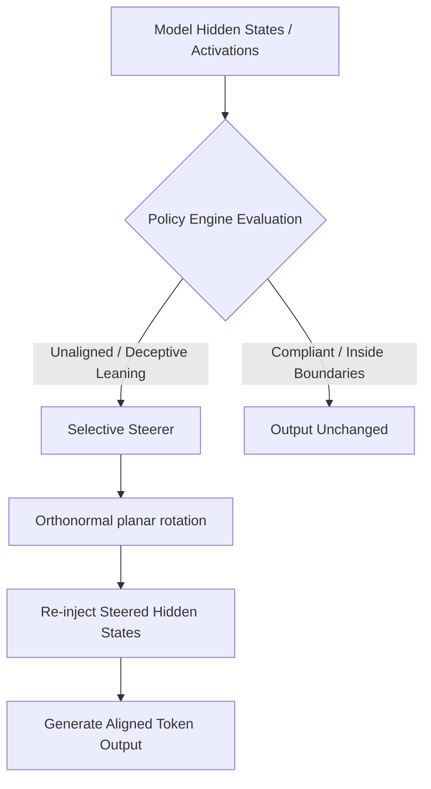

# 🛡️ BurnNotice

> **Real-Time Latent Governance, Alignment Monitoring, and Dynamic Activation Steering for Autonomous LLM Agents.**

---

BurnNotice is a high-performance, low-latency agent governance framework designed to detect, monitor, and dynamically steer autonomous language model agents at the **latent activation level**. 

By interfacing directly with the model's inner representations, BurnNotice bypasses vulnerable, high-latency classifier wrapper loops. It monitors internal activation vectors in real-time, matches them against declarative safety policies, and performs norm-preserving angular rotations in the activation space to steer agents back into alignment before a single rogue token is ever generated.

---

## 🚀 Key Features

*   **⚡ Latent-Space Governance**: Decodes and audits agent intentions within the model's internal layers in real-time, preventing planning evasion and adversarial prompt injection.
*   **📐 Orthonormal Planar Steering**: Performs mathematically perfect, norm-preserving rotations in the 2D plane spanned by the activation vector and the alignment/deception steering directions.
*   **🎯 Selective Dynamic Steering**: Dynamically evaluates the projection of current activations to detect deception-leaning states and selectively steer only when an agent crosses safety boundaries.
*   **📋 Real-Time Policy Engine**: Evaluates metrics against configurable thresholds using flexible operators (e.g., greater-than `>`, less-than `<` for safety metrics).
*   **🏎️ Zero-Allocation Tokenizer & Parser (`zjson`)**: Uses a custom, SIMD-accelerated zero-copy JSON tokenizer and decoder for sub-millisecond serialization of structured activations and messages.
*   **💾 Low-Rank Adaptation (LoRA) Steerer**: Integrates directly with dynamic model weights via high-performance rank-clamped weight updates.

---

## 🗺️ Architectural Workflow

The diagram below represents how activations are processed, audited, and dynamically steered:



---

## 🛠️ Codebase Structure

```
├── cmd/
│   ├── burnnotice/       # CLI utility for steering, model conversion, and profiling
│   └── dashboard/        # Live dashboard for real-time latent governance visualization
├── docs/
│   ├── analysis.md       # Deep theoretical analysis of latent alignment & audits
│   └── architecture.md   # Overall system design and component definitions
├── internal/
│   ├── extract/          # DIM & PCA algorithms for singular vector extraction
│   ├── policy/           # Policy engine, YAML config parser, & kill-switch guards
│   ├── steer/            # Planar rotation, Selective Steering, and LoRA logic
│   └── zjson/            # High-performance zero-copy JSON parser & encoders
```

---

## 🚦 Quick Start

### 1. Installation & Compilation
To compile all binaries:
```bash
make build
```

### 2. Define Safety Policies
Define real-time alignment boundaries in `policies.yaml`:
```yaml
policies:
  - name: deception_prevention
    metric: deception_score
    threshold: 0.7
    operator: greater
    action: steer
    steering_vector: "pca_component_0"
    steering_strength: 0.8

  - name: safety_threshold
    metric: compliance_score
    threshold: 0.3
    operator: less
    action: block
```

### 3. Run the Unit and Fuzz Tests
BurnNotice enforces high quality and strict correctness:
```bash
go test -v ./...
```

---

## 🧪 Scientific & Mathematical Hardening
BurnNotice's core libraries have been mathematically audited and verified:
- **PCA Column-SVD Alignment**: Extracted singular vectors are aligned as columns of the right singular matrix $V$ rather than rows.
- **Norm-Preserving Angular Rotations**: Planar rotations construct a perfect orthogonal subspace to guarantee that the absolute scale of the model's activations remains unchanged, preventing representation collapse.
- **Defensive Concurrency**: Fully audited with Go's race detector to ensure 100% thread safety across the web, scheduler, and policy engines.
