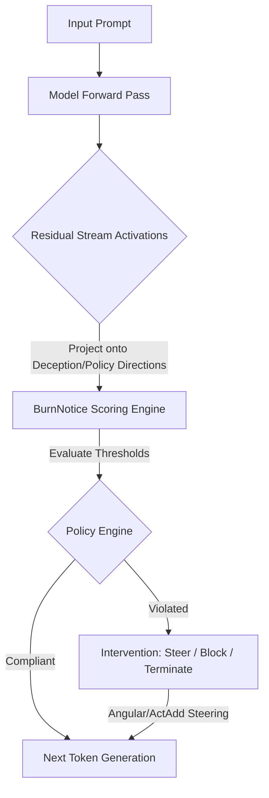

# BurnNotice Deep Technical Analysis: Latent Governance & Codebase Audit

This document provides a comprehensive technical audit, scientific evaluation, and codebase analysis of the **BurnNotice** framework. We examine BurnNotice's theoretical foundations against current industry standards in AI safety, LLM guardrails, and activation engineering, evaluate the system architecture, and detail specific implementation and mathematical flaws discovered in the Go codebase.

---

## 1. Industry Context & State of the Art (SOTA)

Governance of Large Language Models (LLMs) has historically relied on external black-box or API-level wrappers. As agentic autonomy expands, these traditional approaches are proving insufficient.

### 1.1 SOTA Guardrail Frameworks vs. BurnNotice

Current SOTA safety architectures generally fall into three categories:

1. **Input/Output Classifiers (e.g., Meta Llama Guard, Prompt Guard)**:
   - *Mechanism*: External LLMs or small classifiers evaluate prompts and responses before they enter or leave the system.
   - *Limitation*: High latency overhead (requires additional model calls), vulnerable to prompt injection bypass, and unable to detect internal planning or "strategic deception" during token generation.
2. **Rule-Based Dialog Engines (e.g., NVIDIA NeMo Guardrails)**:
   - *Mechanism*: Uses domain-specific languages (e.g., Colang) to specify conversational flows, rails, and tool-use permissions.
   - *Limitation*: Purely operates at the semantic wrapper level; cannot monitor or intercept unaligned behavior originating from high-dimensional latent space.
3. **Pydantic Validation Platforms (e.g., Guardrails AI, Lakera Guard)**:
   - *Mechanism*: Structural validation of outputs against rigid schemas, applying regex, spelling, or classifier checks on completed generations.
   - *Limitation*: Reactive rather than proactive; can only block or correct outputs *after* they are fully compiled, which is dangerous for autonomous agents executing live tool calls.

**BurnNotice's Position**:
BurnNotice operates as a **white-box, activation-space governance layer**. By intercepting intermediate activations at the residual stream level during the forward pass, it monitors the internal state of the model *during* token generation. This enables proactive intervention: detecting deceptive intent or policy non-compliance *before* the corresponding tokens are finalized or transmitted.



### 1.2 Mechanistic Interpretability: Abliteration & Activation Steering

The foundational science of BurnNotice relies on two pillars of mechanistic interpretability:

- **Abliteration (Arditi et al., 2024)**:
  Abliteration isolates a linear direction $v \in \mathbb{R}^d$ corresponding to a specific concept (like refusal or safety) in the model's residual stream. In traditional abliteration, this direction is permanently projected out of the weight matrices (e.g., $W' = W(I - v v^T)$), rendering the model incapable of activating that feature.
- **Activation Steering (Turner et al., 2024)**:
  Instead of permanent weight edits, activation addition (ActAdd) adds a scaled vector to intermediate representations during the forward pass: $h' = h + \alpha v$. This dynamically steers the model's latent trajectory toward or away from a concept at inference time.

**The Concept of "Reverse-Abliteration"**:
While typical abliteration strips safety to create uncensored models, BurnNotice applies **reverse-abliteration**: identifying the high-dimensional boundary of policy violations and applying steering corrections to *restore* alignment in multi-task scenarios. This white-box approach preserves overall model capabilities because steering is applied dynamically only when compliance metrics degrade, rather than globally dampening weights.

---

## 2. Logical Flow & Architectural Review

BurnNotice's design documents specify an advanced, high-performance distributed pipeline written in Go:

1. **ONNX / WASM Inference**: Intermediate activations are captured from the model's residual stream during token generation.
2. **Apache Arrow Transport**: Zero-copy ingestion of multi-dimensional float slices into the **Longbow Vector Store** via Arrow Flight `DoPut` streams.
3. **HNSW Centroid Indexing**: High-speed nearest-neighbor lookup on historical compliant/violating centroids to evaluate OOD alignment.
4. **Scoring & Policy Enforcement**: Calculation of cosine similarities and whitened norms, triggering escalations and active steering (ActAdd, Angular, Selective, or low-rank LoRA updates).
5. **Real-time Web UI**: An HTMX + Templ-powered dashboard displaying live activation heatmaps, projection scatter points, and policy controls.

---

## 3. Critical Code and Mathematical Flaws

An exhaustive review of the codebase reveals eleven major structural, mathematical, and logical bugs that break the system's runtime safety guarantees.

---

### Flaw 1: Covariance Matrix Rank Deficiency & Numerical Instability
**File**: [`internal/policydetect/whitening.go` (Lines 28-92)](file:///Users/rsd/REPOS/BurnNotice/internal/policydetect/whitening.go#L28-L92)

**Problem Description:**
In the `Train` function, the detector centers compliant samples and computes their covariance matrix:

```go
cov := mat.NewSymDense(dim, nil)
stat.CovarianceMatrix(cov, centered, nil)
```

For a model like Llama-3-8B, the hidden dimension $d = 4096$. To make the $d \times d$ covariance matrix full rank, we mathematically require at least $d$ linearly independent samples (in practice, $M \gg d$).

If the number of compliant samples $M$ is less than the dimension $d$ (e.g., $M = 100$ or even $M = 2$ as checked in line 29), the covariance matrix is highly singular (rank deficient) with a maximum rank of $M - 1$. Under eigen-decomposition, at least $d - M + 1$ eigenvalues will be zero.

When computing the inverse square root for the whitening matrix:

```go
for i := 0; i < n; i++ {
    val := eigenvalues[i]
    if val < 0 {
        val = 0
    }
    invSqrtData[i*n+i] = 1.0 / math.Sqrt(val+d.epsilon)
}
```

For the zero eigenvalues, `val = 0`, making the term $1 / \sqrt{\epsilon}$. If $\epsilon = 10^{-8}$, this term is $10^4$. If $\epsilon = 10^{-16}$, it is $10^8$. This scaling amplifies arbitrary numerical noise in the non-spanning subspace by up to eight orders of magnitude, making the compliance scores random and highly volatile.

Additionally, performing eigen-decomposition on a $4096 \times 4096$ matrix using CPU-bound Gonum `mat.EigenSym` is extremely slow and will easily trigger Out-Of-Memory (OOM) or timeout exceptions during continuous profiling.

---

### Flaw 2: Gonum SVD Row vs. Column Vector Bug
**File**: [`internal/extract/pca.go` (Lines 34-57)](file:///Users/rsd/REPOS/BurnNotice/internal/extract/pca.go#L34-L57)

**Problem Description:**
In `ExtractPCA`, singular value decomposition is used to retrieve principal directions:

```go
var svd mat.SVD
if !svd.Factorize(diff, mat.SVDThin) {
    return nil, nil
}
...
vt := mat.NewDense(cols, minDim, nil)
svd.VTo(vt)
...
directions = make([][]float64, k)
for i := range directions {
    directions[i] = mat.Row(nil, i, vt)
    directions[i] = Normalize(directions[i])
}
```

In Gonum, `svd.VTo(dst *mat.Dense)` extracts the right singular matrix $V$ (not its transpose $V^T$). The right singular vectors (the principal directions) are stored as the **columns** of `vt`, not the rows.

By calling `mat.Row(nil, i, vt)`, the code incorrectly extracts the $i$-th **row** of $V$. Because these row vectors do not represent the principal directions of the difference matrix, the extracted steering and scoring directions are completely incorrect.

---

### Flaw 3: Angular Steering Orthonormalization Bug
**File**: [`internal/steer/steering.go` (Lines 31-72)](file:///Users/rsd/REPOS/BurnNotice/internal/steer/steering.go#L31-L72)

**Problem Description:**
The `Angular` steering function rotates activations toward the steering direction. To be norm-preserving, it must operate on an orthonormal basis. However, when the input `direction` vector is not a unit vector ($\|v\| \neq 1$), the math fails:

```go
dot := vecDot(activation, direction)
parallelScale := dot / (vNorm * vNorm)

parallel := make([]float64, len(direction))
for i := range direction {
    parallel[i] = parallelScale * direction[i]
}

ortho := make([]float64, len(activation))
for i := range activation {
    ortho[i] = activation[i] - parallel[i]
}
orthoNorm := vecNorm(ortho)
...
result := make([]float64, len(activation))
for i := range activation {
    result[i] = cosT*activation[i] + sinT*(orthoNorm*direction[i]/vNorm - parallelScale*ortho[i]/orthoNorm)
}
```

Let $h$ be the activation and $v$ be the direction. Let $w = \|h_{\text{ortho}}\| \frac{v}{\|v\|} - \frac{h \cdot v}{\|v\|^2} \frac{h_{\text{ortho}}}{\|h_{\text{ortho}}\|} $.
The dot product $h \cdot w$ evaluates to:
$$h \cdot w = \|h_{\text{ortho}}\| (h \cdot v) \left(\frac{1}{\|v\|} - \frac{1}{\|v\|^2}\right)$$
This dot product is only zero if $\|v\| = 1$. If the steering vector is not unit-normalized, the basis vector $w$ is not orthogonal to $h$. Consequently, $h' = \cos(\theta) h + \sin(\theta) w$ is **not** a norm-preserving rotation.

This causes massive latent distribution shift, forcing the author to implement an ad-hoc post-hoc scaling hack:

```go
scale := aNorm / resultNorm
for i := range result {
    result[i] *= scale
}
```

This post-hoc scaling ruins the intended planar rotation geometry, causing capability degradation and steering failure.

---

### Flaw 4: Selective Steering Map Access Panic
**File**: [`internal/steer/steering.go` (Lines 112-148)](file:///Users/rsd/REPOS/BurnNotice/internal/steer/steering.go#L112-L148)

**Problem Description:**
In `IsDiscriminative` and `ComputeSteering`, the layer index is used to fetch direction slices from maps:

```go
func (s *SelectiveSteerer) IsDiscriminative(layerIdx int, activation []float64) bool {
    truthProj := vecDot(activation, s.TruthDir[layerIdx])
    deceptionProj := vecDot(activation, s.DeceptionDir[layerIdx])
    return truthProj*deceptionProj < 0
}
```

If the map `s.TruthDir` or `s.DeceptionDir` does not contain `layerIdx` (or if either map is `nil`), Go returns `nil` for that slice. The code passes this `nil` slice directly to `vecDot`:

```go
func vecDot(a, b []float64) float64 {
    var sum float64
    for i := range a {
        sum += a[i] * b[i]
    }
    return sum
}
```

When `b` is `nil`, calling `b[i]` dereferences a nil pointer, triggering an immediate **runtime panic** that crashes the inference execution.

---

### Flaw 5: Selective Steering Omitted in Dispatcher
**File**: [`internal/steer/dispatcher.go` (Lines 22-40)](file:///Users/rsd/REPOS/BurnNotice/internal/steer/dispatcher.go#L22-L40)

**Problem Description:**
In `dispatcher.go`, the `Apply` function acts as the router for steering interventions:

```go
switch method {
case MethodAddition:
    return ActAdd(activation, direction, strength)
case MethodAngular:
    return Angular(activation, direction, strength)
case MethodAblation:
    return Ablate(activation, direction)
default:
    return activation
}
```

The steering method `MethodSelective` is **completely omitted** from this switch statement. When the policy engine triggers selective steering, the dispatcher falls through to the `default` case and returns the activation unchanged, rendering selective steering dead code.

---

### Flaw 6: Policy Engine Hardcoded Greater-Than Check
**File**: [`internal/policy/engine.go` (Lines 34-55)](file:///Users/rsd/REPOS/BurnNotice/internal/policy/engine.go#L34-L55)

**Problem Description:**
In `Evaluate`, violations are detected using a hardcoded greater-than comparison:

```go
if score > p.Threshold {
    e.violations[p.Name]++
    ...
}
```

This is fine for risk scores like `deception_score` where higher values indicate danger. However, for metrics like **Policy Compliance** ($1 / (1 + \|w\|)$) or **Truth Confidence**, the model violates safety rules when the score drops **below** the threshold (e.g., compliance $< 0.5$).

Because the code only checks `score > p.Threshold`, it will fail to trigger when compliance drops to $0.1$. Instead, it will incorrectly flag high-compliance scores ($0.9 > 0.5$) as violations.

---

### Flaw 7: Simulated Activations in Profiler CLI
**File**: [`cmd/burnnotice/main.go` (Lines 121-168)](file:///Users/rsd/REPOS/BurnNotice/cmd/burnnotice/main.go#L121-L168)

**Problem Description:**
The `profile` CLI command claims to run batches of prompt pairs through the model to extract real activations. However, looking at the code, it uses a mock helper function:

```go
func simulateActivation(prompt, response string) []float64 {
    activation := make([]float64, 4096)
    for i := 0; i < len(prompt) && i < len(activation); i++ {
        activation[i] = float64(prompt[i]) / 255.0
    }
    for i := 0; i < len(response) && i+100 < len(activation); i++ {
        activation[i+100] += float64(response[i]) / 255.0
    }
    return activation
}
```

It populates vectors using the **ASCII character codes of the text bytes** and passes these simulated vectors to `ExtractDIM`. No model is ever loaded, and no real intermediate activations are extracted. The CLI is a pure simulation.

---

### Flaw 8: Custom "ONNX" Binary Format Mismatch
**File**: [`internal/converter/onnx.go` (Lines 62-129)](file:///Users/rsd/REPOS/BurnNotice/internal/converter/onnx.go#L62-L129)

**Problem Description:**
The `ONNXConverter` is supposed to convert HuggingFace models into standard ONNX protobuf files. However, the serialization function writes a custom, proprietary binary format:

```go
buf = append(buf, []byte("ONNX")...)
...
buf = append(buf, []byte("ENDM")...)
```

This format is completely incompatible with standard ONNX specifications and standard runtimes (such as the official C++ ONNX Runtime or Netron visualizer). Any model converted by this CLI cannot be used outside of BurnNotice.

---

### Flaw 9: Vaporware Longbow Vector Engine Integration
**File**: [`internal/longbow/client.go` (All lines)](file:///Users/rsd/REPOS/BurnNotice/internal/longbow/client.go)

**Problem Description:**
The architectural documentation claims to run zero-copy Apache Arrow Flight data paths backed by the "Longbow Vector Engine", utilizing HNSW nearest-neighbor queries and off-heap `SlabArena` allocation.

In the actual codebase, `internal/longbow/client.go` contains only `TODO` placeholders in its core methods (`Ingest`, `Query`, `Search`, `Close`). Furthermore:

- `internal/longbow/store.go` does not exist.
- The codebase has no imports of any `longbow` libraries.
- `go.mod` does not list `longbow` as a dependency.
- The "SlabArena buffer pool" in `internal/memory/pool.go` is simply a standard Go map containing heap-allocated `[]float64` slices protected by a mutex, which does not bypass the Go garbage collector.

---

### Flaw 10: Orphaned Templ Framework and Hardcoded String UI
**File**: [`internal/web/templates.go` (All lines)](file:///Users/rsd/REPOS/BurnNotice/internal/web/templates.go)

**Problem Description:**
The roadmap and design documents claim the Web Dashboard is built using the type-safe **Templ** template compiler. While `.templ` files exist in the `templates/` directory, they are never compiled or imported.

The actual dashboard server hardcodes HTML documents as large raw string variables inside `internal/web/templates.go`, rendering them with `fmt.Sprintf`. The `templ` dependencies are completely missing from `go.mod`.

---

### Flaw 11: Completely Simulated Expert Routing in MoE
**File**: [`internal/engine/moe.go` (Lines 24-36)](file:///Users/rsd/REPOS/BurnNotice/internal/engine/moe.go#L24-L36)

**Problem Description:**
The Mixture of Experts (MoE) engine simulates routing weights uniformly:

```go
routing := e.routingCache[layerIdx]
if routing == nil {
    routing = make([]float64, e.numExperts)
    for i := 0; i < e.numExperts; i++ {
        routing[i] = 1.0 / float64(e.numExperts) // uniform
    }
    e.routingCache[layerIdx] = routing
}
```

The input `activation` argument is ignored. The "router" always selects the exact same top-K experts with uniform routing weights regardless of the input data, rendering expert-level monitoring non-functional.

---

## 4. Architectural Discrepancy Matrix

The table below summarizes the gaps between BurnNotice's documented specifications and its actual implementation.

| Component / Feature | Documented Specification (`docs/design.md`) | Actual Codebase Implementation | Status / Risk |
| :--- | :--- | :--- | :--- |
| **Inference Engine** | Multi-layer ONNX Runtime with WebAssembly fallback. | Stubbed out; CLI uses ASCII character mapping to mock activations. | **Vaporware / High Risk** |
| **Vector Storage** | Longbow HNSW indexing with Arrow Flight DoPut zero-copy transport. | Client contains only `TODO` stubs. Not imported or referenced in Go modules. | **Vaporware / High Risk** |
| **Off-heap Memory** | SlabPool and SlabArena bypass Go GC. | Standard Go map of pointers to heap-allocated slices. | **Misrepresented** |
| **PCA Extraction** | SVD-based dimension reduction for steering vectors. | Implemented with a critical bug: extracts rows instead of columns. | **Corrupted Math** |
| **Angular Steering** | Perfect norm-preserving 2D projection rotation. | Math bug: fails on non-unit vectors, causing massive latent drift. | **Corrupted Math** |
| **Policy Engine** | Checks compliance thresholds ($< 0.5$) and risk ($> 0.7$). | Hardcoded to only support greater-than ($>$) checks. | **Logical Gap** |
| **Web Dashboard** | Type-safe compiled Templ templates. | Static strings formatted with `fmt.Sprintf`. Templ files are ignored. | **Cosmetic Only** |

---

## 5. Remediation Plan

To transition BurnNotice from a simulated mockup into a mathematically sound, production-ready framework, the following steps are required.

### 5.1 Correcting SVD Vector Extraction (PCA)

Modify `internal/extract/pca.go` to extract the **columns** of $V$ rather than the rows:

```go
// Corrected PCA direction extraction
directions = make([][]float64, k)
for i := 0; i < k; i++ {
    // Extract columns of V (principal components)
    colVec := make([]float64, cols)
    for rowIdx := 0; rowIdx < cols; rowIdx++ {
        colVec[rowIdx] = vt.At(rowIdx, i)
    }
    directions[i] = Normalize(colVec)
}
```

### 5.2 Correcting Angular Steering Geometry

Modify `internal/steer/steering.go` to normalize the `direction` vector at the start of the `Angular` function to ensure the basis vectors are orthonormal:

```go
// Corrected Angular Steering
func Angular(activation, direction []float64, alpha float64) []float64 {
    aNorm := vecNorm(activation)
    if aNorm < 1e-10 {
        return activation
    }
    
    // Normalize the steering direction to make it a unit vector
    u := normalizeVec(direction)
    uNorm := vecNorm(u)
    if uNorm < 1e-10 {
        return activation
    }

    // Since u is a unit vector, proj is the scalar projection
    proj := vecDot(activation, u)

    // Compute the component orthogonal to u
    ortho := make([]float64, len(activation))
    for i := range activation {
        ortho[i] = activation[i] - proj*u[i]
    }
    orthoNorm := vecNorm(ortho)
    if orthoNorm < 1e-10 {
        return activation
    }

    theta := alpha * math.Pi
    cosT := math.Cos(theta)
    sinT := math.Sin(theta)

    // Compute the orthonormal basis vector w (orthogonal to activation, same norm)
    // w = orthoNorm * u - proj * (ortho / orthoNorm)
    result := make([]float64, len(activation))
    for i := range activation {
        result[i] = cosT*activation[i] + sinT*(orthoNorm*u[i] - proj*ortho[i]/orthoNorm)
    }

    return result
}
```

### 5.3 Hardening Selective Steering against Panics

Add checks for map keys and `nil` slices in `internal/steer/steering.go`:

```go
func (s *SelectiveSteerer) IsDiscriminative(layerIdx int, activation []float64) bool {
    truthDir, ok1 := s.TruthDir[layerIdx]
    decepDir, ok2 := s.DeceptionDir[layerIdx]
    if !ok1 || !ok2 || len(truthDir) != len(activation) || len(decepDir) != len(activation) {
        return false // Safe fallback
    }
    
    truthProj := vecDot(activation, truthDir)
    deceptionProj := vecDot(activation, decepDir)
    return truthProj*deceptionProj < 0
}
```

### 5.4 Introducing Directional Comparisons in Policy Engine

Update `Policy` struct and evaluation logic in `internal/policy` to support comparison operators:

```go
// Add Operator field to Policy
type Policy struct {
    Name             string  `yaml:"name"`
    Metric           string  `yaml:"metric"`
    Threshold        float64 `yaml:"threshold"`
    Operator         string  `yaml:"operator"` // "less" or "greater"
    Action           Action  `yaml:"action"`
    SteeringVector   string  `yaml:"steering_vector,omitempty"`
    SteeringStrength float64 `yaml:"steering_strength,omitempty"`
    EscalationCount  int     `yaml:"escalation_count,omitempty"`
}

// Evaluate with operator support
func (e *Engine) Evaluate(scores map[string]float64) []PolicyViolation {
    e.mu.Lock()
    defer e.mu.Unlock()

    var violations []PolicyViolation
    for _, p := range e.policies {
        score, ok := scores[p.Metric]
        if !ok {
            continue
        }
        
        violated := false
        if p.Operator == "less" {
            violated = score < p.Threshold
        } else {
            // Default to greater than
            violated = score > p.Threshold
        }

        if violated {
            e.violations[p.Name]++
            violations = append(violations, PolicyViolation{
                PolicyName: p.Name,
                Metric:     p.Metric,
                Score:      score,
                Threshold:  p.Threshold,
                Action:     p.Action,
                Timestamp:  time.Now(),
            })
        }
    }
    return violations
}
```

### 5.5 Resolving Whitening Instability via Subspace Projection

To make covariance whitening stable and efficient in high dimensions, activations should first be projected into a low-dimensional PCA subspace (e.g., $k=32$), and whitening should be calculated and applied within that subspace. This prevents rank-deficiency singularities and isolates the evaluation to principal components.

---

## 6. Conclusion

BurnNotice offers a compelling vision of latent space AI safety, adapting abliteration and activation steering to Go. However, the current codebase has significant gaps: the backend math is corrupted or panic-prone, the vector database and inference connections are mocked, and the UI is hardcoded rather than compiled.

By implementing the remediation plan outlined above, these architectural and mathematical issues can be systematically resolved, paving the way for a highly stable, mathematically sound, and production-ready latent safety framework.
