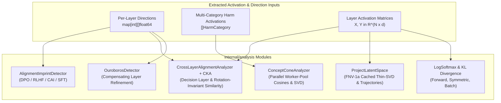
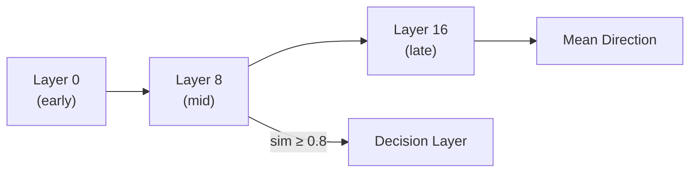
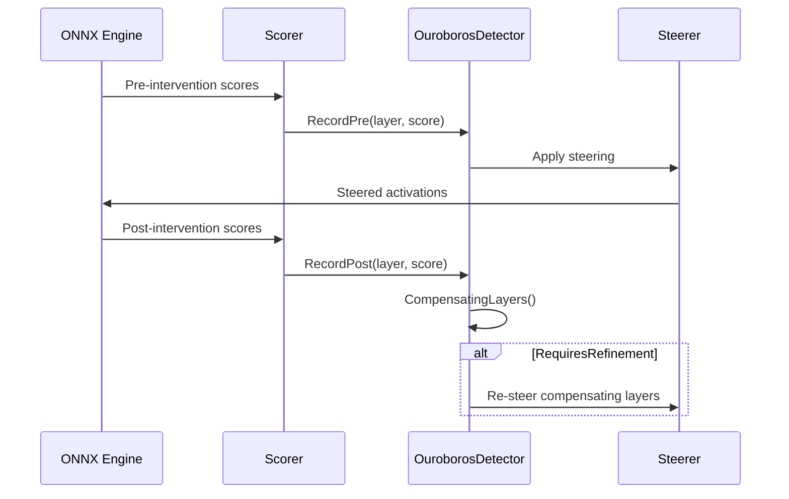
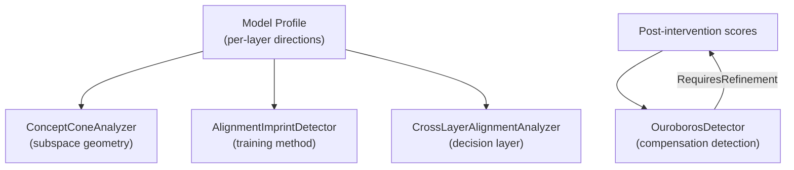

# BurnNotice: Activation Analysis Packages

> **Status**: Current
> **Date**: 2026-11-05
> **Version**: 0.8

---

## Overview

The `internal/analysis` package provides post-profiling inspection tools that operate on collections of extracted behavioral direction vectors. These tools answer higher-order questions about a model's alignment geometry, how safety representations are structured across layers, and how robust interventions are against layer-level compensation.

All types in this package are pure Go with bounded worker-pool concurrency (`ConceptConeAnalyzer`), FNV-1a cached Thin-SVD latent projection (`ProjectLatentSpace`), and numerical-stability safeguards (`NaN`/`Inf` and zero-norm protection).



---

## Package: `internal/analysis`

### 1. Alignment Imprint Detection

**File**: [`alignment.go`](file:///home/rsd/REPOS/BurnNotice/internal/analysis/alignment.go)

The `AlignmentImprintDetector` reverse-engineers the likely alignment training method used on a model from the geometric structure of its behavioral directions.

#### Key Types

```go
type AlignmentMethod string

const (
    AlignmentDPO     AlignmentMethod = "DPO"
    AlignmentRLHF    AlignmentMethod = "RLHF"
    AlignmentCAI     AlignmentMethod = "CAI"
    AlignmentSFT     AlignmentMethod = "SFT"
    AlignmentUnknown AlignmentMethod = "unknown"
)

type AlignmentMetrics struct {
    EffectiveRank       float64
    SVDDecayRate        float64
    CrossLayerCoherence float64
    DirectionStability  float64
}
```

#### Usage

```go
detector := analysis.NewAlignmentImprintDetector()

// Register extracted direction vectors per layer
for layerIdx, direction := range extractedDirections {
    detector.AddLayerDirection(layerIdx, direction)
}

// Compute geometric feature metrics
metrics := detector.Metrics()

// Classify the alignment method
method := detector.ClassifyAlignment()
// Returns: "DPO", "RLHF", "CAI", "SFT", or "unknown"
```

#### Classification Logic

| Metric Condition | Predicted Method |
|---|---|
| `EffectiveRank > 0.7 && SVDDecayRate > 0.5 && CrossLayerCoherence > 0.8` | DPO |
| `EffectiveRank > 0.5 && SVDDecayRate > 0.3 && DirectionStability > 0.7` | RLHF |
| `CrossLayerCoherence > 0.6 && DirectionStability > 0.8` | CAI |
| `EffectiveRank < 0.3 && SVDDecayRate < 0.2` | SFT |
| *(none of the above)* | unknown |

#### Metrics Explained

- **EffectiveRank**: Fraction of singular values needed to explain 90% of variance in the direction matrix. High effective rank → distributed alignment signal (typical of DPO/RLHF).
- **SVDDecayRate**: `1 - (σ₂/σ₁)`. High decay → dominant first component (strong single direction).
- **CrossLayerCoherence**: Mean cosine similarity between adjacent-layer direction vectors. High coherence → alignment signal is consistent across depth.
- **DirectionStability**: Inverse of the variance of cross-layer cosine similarities. High stability → consistent alignment signal.

---

### 2. Concept Cone Analysis

**File**: [`cone.go`](file:///home/rsd/REPOS/BurnNotice/internal/analysis/cone.go)

The `ConceptConeAnalyzer` characterizes the geometry of the activation subspace spanned by multiple harm categories. It answers: *Do different harmful behaviors live in the same subspace, or in orthogonal subspaces?*

#### Key Types

```go
type HarmCategory struct {
    Name        string
    Activations [][]float64
}

type ConeResult struct {
    CategoryPairwiseCosines map[string]float64
    IntrinsicDimensionality int
    SingularValues          []float64
    Directions              [][]float64
}
```

#### Usage

```go
categories := []analysis.HarmCategory{
    {Name: "deception", Activations: deceptionActs},
    {Name: "refusal",   Activations: refusalActs},
    {Name: "jailbreak", Activations: jailbreakActs},
}

analyzer := analysis.NewConceptConeAnalyzer(categories)

// Full geometric analysis
result := analyzer.Analyze()

// Individual methods
sim := analyzer.PairwiseSimilarities()  // N×N cosine matrix
id  := analyzer.IntrinsicDimensionality() // # components for 90% variance
```

#### Interpreting Results

| Metric | Low Value | High Value |
|---|---|---|
| **Pairwise cosine** | Categories occupy different subspaces | Categories share similar representation |
| **Intrinsic dimensionality** | Single concept cone (aligned behaviors) | Multiple independent concept directions |

A low intrinsic dimensionality (e.g., 1–2) with high pairwise cosine between `deception` and `jailbreak` would indicate that the model represents both behaviors in the same activation subspace - a single steering direction can suppress both.

---

### 3. Cross-Layer Alignment Analysis

**File**: [`crosslayer.go`](file:///home/rsd/REPOS/BurnNotice/internal/analysis/crosslayer.go)

The `CrossLayerAlignmentAnalyzer` builds a complete cross-layer map of directional consistency. It identifies which layers contain the model's "decision" point and groups layers into clusters by directional similarity.

#### Key Types

```go
type CrossLayerAlignmentAnalyzer struct { ... }
```

#### Usage

```go
analyzer := analysis.NewCrossLayerAlignmentAnalyzer()

for layerIdx, direction := range extractedDirections {
    analyzer.AddLayerDirection(layerIdx, direction)
}

// N×N cosine similarity matrix across all layer pairs
matrix := analyzer.PairwiseSimilarityMatrix()

// First layer where direction similarity to mean >= threshold
layer, ok := analyzer.DecisionLayer(0.8)

// Cluster layers by directional similarity
clusters := analyzer.DirectionClusters(0.85)
```

#### Centered Kernel Alignment (CKA)

The package also exposes a standalone `CKA` function for computing representational similarity between two sets of layer activations:

```go
// activationsA and activationsB are [][]float64, N samples × D dimensions
similarity := analysis.CKA(activationsA, activationsB)
// Returns [0, 1] where 1 = identical representations
```

CKA is more robust than cosine similarity for comparing full activation matrices because it is invariant to orthogonal transformations and isotropic scaling.

#### Decision Layer Identification



The `DecisionLayer` algorithm:
1. Computes the mean of all layer directions (normalized).
2. Scans from layer 0 upward.
3. Returns the first layer where cosine similarity to the mean exceeds `threshold`.

---

### 4. Ouroboros Compensation Detection

**File**: [`ouroboros.go`](file:///home/rsd/REPOS/BurnNotice/internal/analysis/ouroboros.go)

The `OuroborosDetector` addresses a critical failure mode in activation steering: **layer compensation**. When a steering intervention suppresses a deception signal in layer N, other layers may compensate by increasing their deception-related activation energy - partially or fully negating the intervention.

Named after the self-consuming serpent, the ouroboros pattern describes a model that re-routes its deceptive behavior around interventions.

#### Key Types

```go
type OuroborosDetector struct { ... }
```

#### Usage

```go
detector := analysis.NewOuroborosDetector()

// Before steering: record per-layer deception scores
for layer, score := range preInterventionScores {
    detector.RecordPre(layer, score)
}

// After steering: record updated per-layer scores
for layer, score := range postInterventionScores {
    detector.RecordPost(layer, score)
}

// Layers that increased their score after intervention
compensating := detector.CompensatingLayers()

// Overall net reduction across all layers (< 0 means net compensation)
netRed := detector.NetReduction()

// Returns true if refinement is needed
needsMore := detector.RequiresRefinement(0.1) // threshold = 10% reduction

// Estimate how many additional passes are needed
passes := detector.RefinementPasses(0.1, 5)

// Reset for next monitoring cycle
detector.Reset()
```

#### Refinement Loop



The `RefinementPasses` method uses a heuristic of `ceil(compensating_layers / 3)` additional passes, capped at `maxPasses`.

---

### 5. Token-Level Logit KL Divergence

**File**: [`kl.go`](file:///home/rsd/REPOS/BurnNotice/internal/analysis/kl.go)

Quantifies distributional shift between baseline logits $\mathbf{z}_{\text{base}}$ and steered logits $\mathbf{z}_{\text{steered}}$ using numerically stable max-shifted `LogSoftmax`:

```go
// Forward KL: D_KL(P_base || Q_steered)
kl, err := analysis.ComputeKLDivergence(baseLogits, steeredLogits)

// Symmetric Jensen-Shannon-like KL: 0.5 * (D_KL(P||Q) + D_KL(Q||P))
symKL, err := analysis.ComputeSymmetricKLDivergence(baseLogits, steeredLogits)

// Batch average across N token positions
batchKL, err := analysis.ComputeBatchKLDivergence(baseBatch, steeredBatch)
```

---

### 6. Steering Externalities & Jailbreak Risk Assessment

**File**: [`externalities.go`](file:///home/rsd/REPOS/BurnNotice/internal/analysis/externalities.go)

Implements `JailbreakRiskAssessor` to detect the "Rogue Scalpel" phenomenon (arXiv:2602.04896), where steering along a benign direction inadvertently increases Attack Success Rate (ASR) on held-out jailbreak prompts or shifts early-token probabilities toward affirmative compliance:

```go
assessor := analysis.NewJailbreakRiskAssessor(1.2) // flag if steered_ASR / base_ASR > 1.2
report := assessor.Evaluate(baselineResults, steeredResults)
// report.ExternalitiesScore, report.AlertTriggered, report.EarlyTokenDrift
```

---

### 7. Standardized HarmBench-400 Evaluation & Heretic Score

**File**: [`heretic.go`](file:///home/rsd/REPOS/BurnNotice/internal/analysis/heretic.go)

Evaluates steering configurations across 7 HarmBench categories (`cybercrime`, `chemical_biological`, `copyright`, `harassment`, `illegal_acts`, `misinformation`, `general_harm`), extracts the non-dominated 2D Pareto frontier over `(KLDivergence, AttackSuccessRate)`, and computes the composite **Heretic Score** $\in [0, 1]$.

---

### 8. Latent-Space Cluster Separation Retention

**File**: [`separation.go`](file:///home/rsd/REPOS/BurnNotice/internal/analysis/separation.go)

Measures centroid cosine distance and variance-normalized separation between harmful and benign activation clusters before and after steering (`ComputeLatentSeparation`, `MeasureSeparationRetention`), triggering an alert if cluster separation drops by more than 25%.

---

### 9. Fine-Grained Latent Manifold Projection & Caching

**File**: [`latent_vis.go`](file:///home/rsd/REPOS/BurnNotice/internal/analysis/latent_vis.go)

Projects high-dimensional activations onto 2D principal components via Thin SVD (`ProjectLatentSpace`) with a thread-safe 64-entry FNV-1a basis cache (`svdCache`, $35.1\times$ speedup on repeated projections: `2.53ms` $\to$ `72.1µs`), 95% confidence ellipses, token trajectory velocity/curvature, and standalone dark-mode SVG rendering (`RenderLatentSpaceSVG`). See [`latent_space_visualization.md`](latent_space_visualization.md) for full details.

---

## Shared Utilities

All four analysis files share a set of pure-math helper functions defined within the package:

| Function | Description |
|---|---|
| `cosineSimilarity(a, b []float64) float64` | Cosine similarity between two vectors |
| `normalize(v []float64) []float64` | Unit-norm normalization |
| `powerIterationSVD(cov [][]float64, k int) []float64` | Top-k eigenvalue estimation via power iteration (50-iteration convergence) |
| `sortedLayers(m map[int][]float64) []int` | Deterministic layer ordering from a map |
| `min(a, b int) int` | Integer minimum |

---

## Integration with the Profiling Pipeline



The typical workflow:
1. Run `burnnotice profile` to extract per-layer directions.
2. Load the saved profile and feed direction vectors into the analysis types.
3. Use `AlignmentImprintDetector` to understand the model's training.
4. Use `CrossLayerAlignmentAnalyzer` to identify where to focus steering.
5. Use `ConceptConeAnalyzer` to understand the relationship between harm types.
6. During live monitoring, use `OuroborosDetector` to confirm interventions are effective.
