# BurnNotice: Architecture Overview

> **Status**: Current
> **Date**: 2026-06-12
> **Version**: 0.6

---

## System Overview

BurnNotice is a real-time neural activation monitoring and intervention framework designed to detect when an LLM agent is considering deception, policy violation, or alignment drift — before the behavior manifests in output. The system operates entirely in Go with ONNX-based model inference, WebAssembly (WASM) execution for portable deployment, and Longbow's Apache Arrow Flight vector engine for high-performance activation storage and processing.

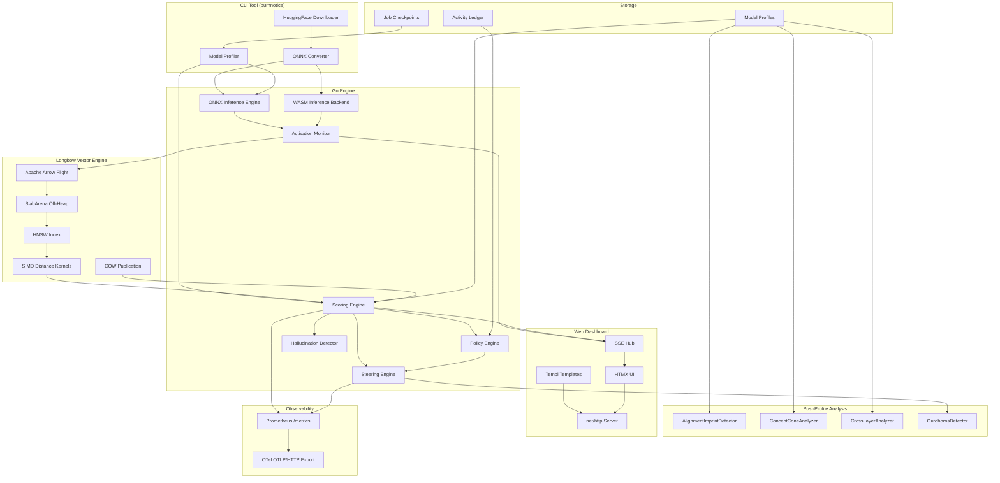

---

## Longbow Vector Engine Integration

BurnNotice leverages Longbow (github.com/23skdu/longbow) as its activation storage and processing backbone. Longbow provides:

### Zero-Copy Activation Transport

Activations flow from ONNX inference directly into Longbow's Apache Arrow Flight store without serialization overhead. Arrow RecordBatches enable batch processing of thousands of activation vectors simultaneously.

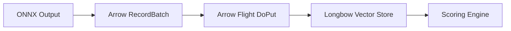

### Off-Heap Memory Management

Longbow's SlabArena allocates activation matrices in 1MB contiguous slabs outside Go's heap, bypassing GC pressure from billion-scale float32 allocations. The SlabPool reclaims memory via `Munmap` to prevent virtual memory fragmentation.

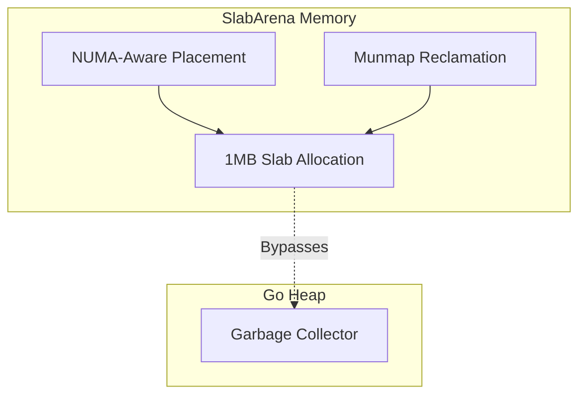

### SIMD-Optimized Distance Calculations

All activation scoring (cosine similarity, euclidean distance, dot product) uses Longbow's hand-optimized SIMD kernels instead of gonum:

| Architecture | Optimization | Throughput Gain |
| --- | --- | --- |
| AVX2 (x86) | 256-bit vectorized dot product | 3-4x |
| AVX-512 (x86) | 512-bit vectorized + softmax kernels | 5-8x |
| NEON (ARM64) | 128-bit vectorized for Apple Silicon/Graviton | 3-4x |
| TurboQuant | FWHT-optimized bit-packing | 8x |

### HNSW Index for Centroid Lookup

The HNSW index enables fast nearest-neighbor lookups on activation centroids, used for:

- Conflict subspace detection (find nearest conflict centroid)
- Policy violation detection (find nearest policy-violating cluster)
- Truth direction validation (verify activation proximity to truth subspace)

### COW Publication for Lock-Free Scoring

Longbow's Copy-On-Write publication model enables lock-free concurrent scoring. When new activations are ingested, a new version of the graph data is created and published via atomic pointer swap. Scoring goroutines read the stable version without acquiring locks.

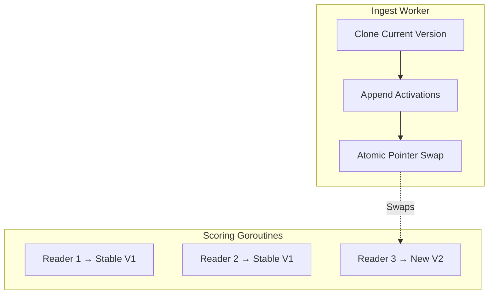

### Distributed Activation Sharing

For multi-node deployments, Longbow's gossip-based mesh enables activation sharing across cluster nodes. Consistent hashing partitions activation data, and load-aware routing steers scoring requests to the least-loaded node.

---

## Component Architecture

### ONNX Inference Engine

Loads and executes models in ONNX format. Forward hooks capture intermediate activations at specified layers for monitoring and profiling.

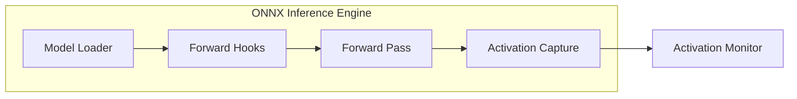

### WASM Execution Backend

For environments without GPU access or where ONNX Runtime is unavailable, BurnNotice supports WASM-based inference using `wazero`. ONNX models are compiled to WASM via `webnn` or `onnx2wasm`, enabling pure Go execution.

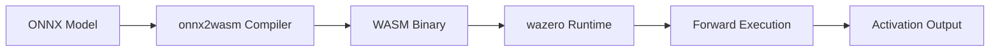

### Activation Scoring Pipeline

Receives activation streams from the inference engine, computes scoring metrics against registered direction profiles, and triggers steering interventions when thresholds are exceeded.

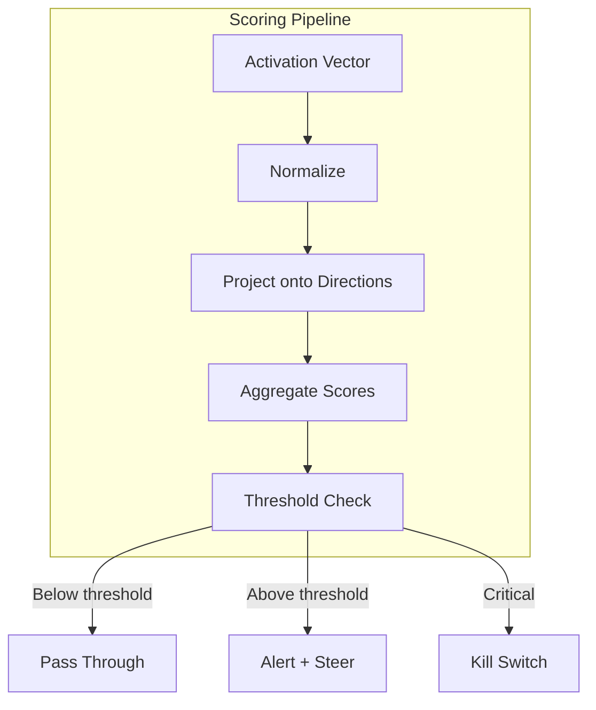

### Steering Intervention Flow

When a score exceeds its configured threshold, one of four steering interventions is applied:

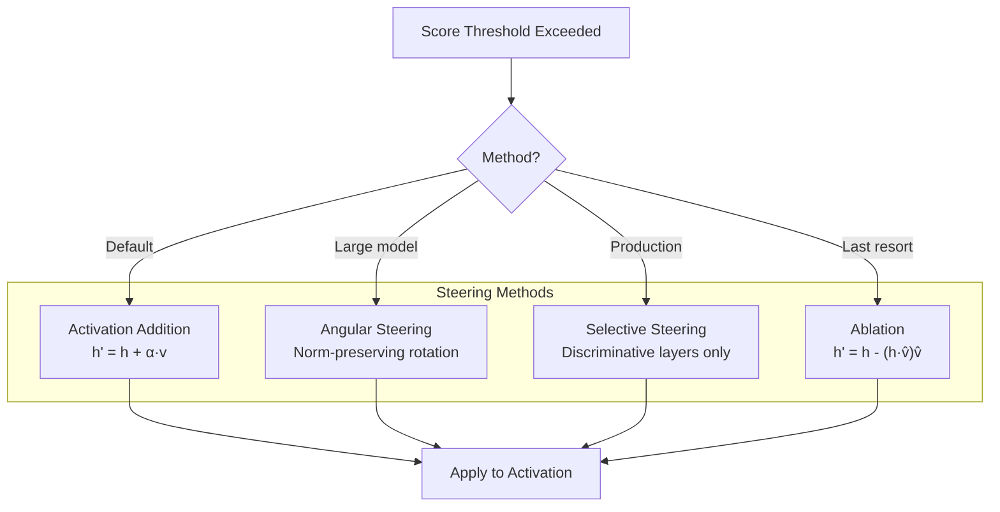

### Web Dashboard Architecture

The monitoring dashboard uses Go's `net/http` server, Templ for type-safe HTML templates, and HTMX for dynamic updates without a JavaScript framework. Real-time data flows via Server-Sent Events (SSE).

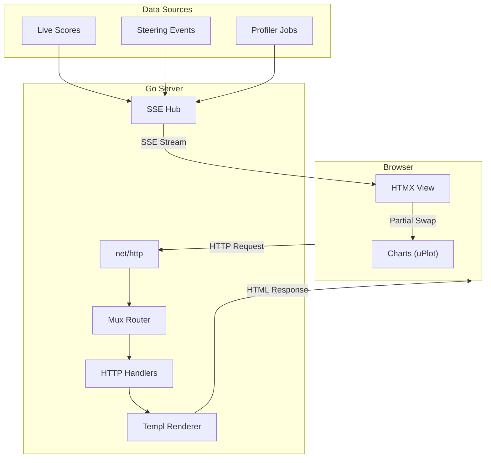

### Model Profiling Pipeline

Each model requires a profile that identifies its unique activation-space geometry. The profiling pipeline extracts behavioral directions, subspaces, and truth neurons. After profiling, the `internal/analysis` package provides higher-order geometric inspection.

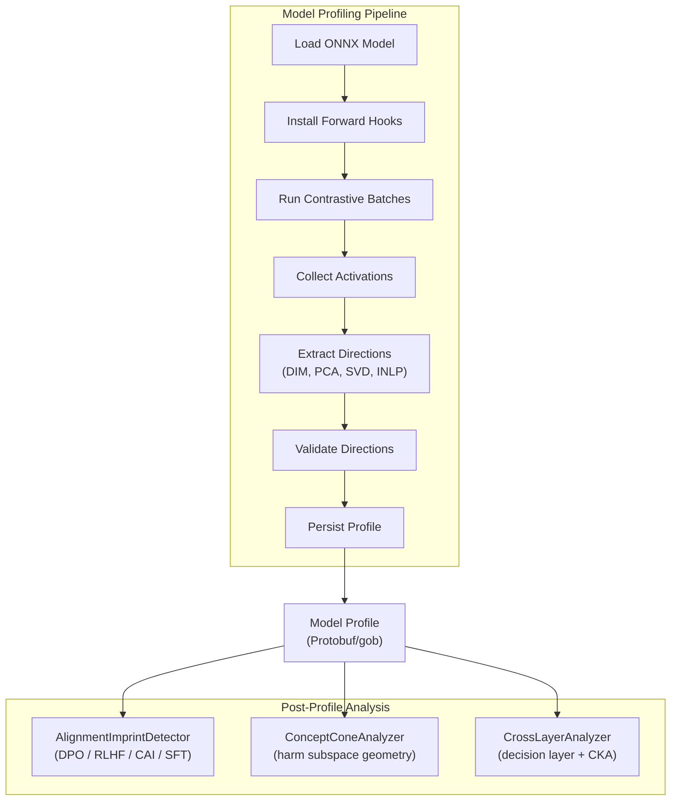

### Long-Running Architecture

BurnNotice is designed for continuous operation profiling and monitoring LLM deployments with memory pooling, layer subsampling, and checkpointing.

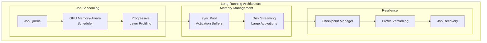

---

## Data Flow

### Inference-Time Monitoring

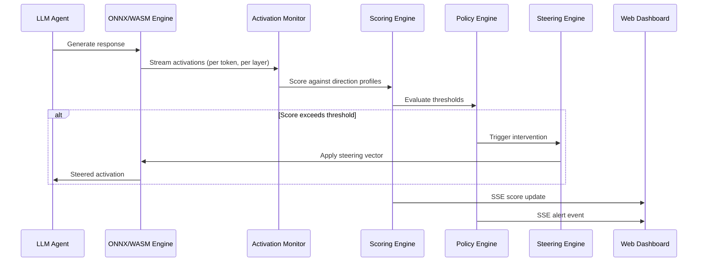

### Model Profiling

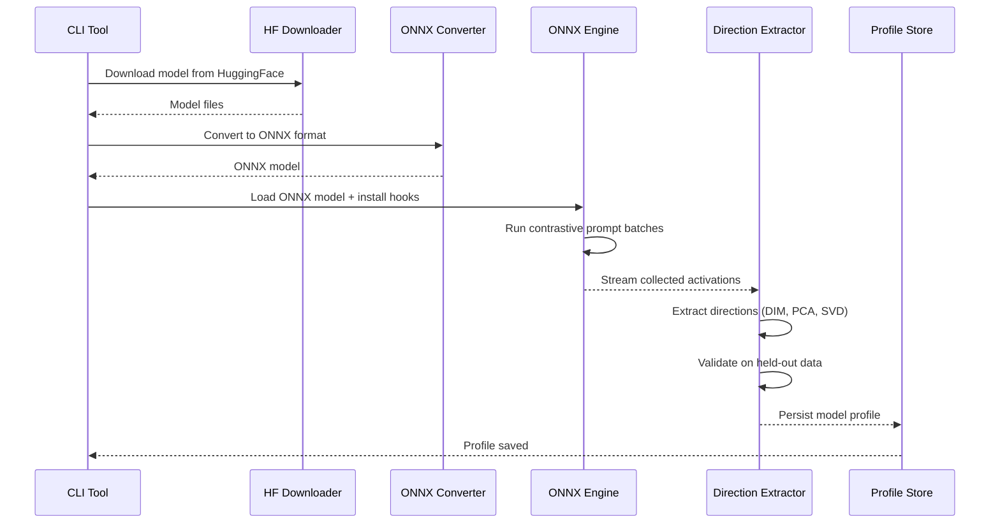

---

## Technology Stack

| Component | Technology | Purpose |
| --- | --- | --- |
| **Primary Language** | Go | Concurrency, memory efficiency, single binary |
| **Model Inference** | ONNX Runtime | Portable model execution across CPU/GPU |
| **Fallback Inference** | WASM (wazero) | Pure Go execution, no native dependencies |
| **Vector Engine** | Longbow (Apache Arrow Flight) | Zero-copy activation storage, SIMD distance, HNSW |
| **Off-Heap Memory** | Longbow SlabArena | 1MB slab allocation, NUMA-aware, bypasses Go GC |
| **Distance Kernels** | Longbow SIMD (AVX2/AVX-512/NEON) | 3-8x faster cosine, euclidean, dot product |
| **Linear Algebra** | gonum.org/v1/gonum | Direction extraction (DIM, PCA, SVD, whitening) |
| **Analysis** | `internal/analysis` | Alignment imprint, concept cone, cross-layer CKA, ouroboros detection |
| **Hallucination Detection** | `internal/hallucination` | SAE-energy rolling-window spike detection |
| **CLI Framework** | cobra | HuggingFace download, ONNX conversion, profiling |
| **Web Server** | net/http | Built-in HTTP server |
| **Templates** | Templ | Type-safe HTML generation |
| **Dynamic UI** | HTMX | Partial page updates, SSE integration |
| **Real-time** | Server-Sent Events | Live score streaming to dashboard |
| **Serialization** | Protocol Buffers / gob | Profile storage, checkpointing |
| **Charting** | uPlot | Lightweight activation visualizations |
| **Metrics** | Prometheus + OTel OTLP/HTTP | 50+ instruments; push/pull dual-backend observability |
| **Scripts** | Python 3 (`scripts/`) | Research utilities (arxiv paper post-processing) |

---

## Deployment Topology

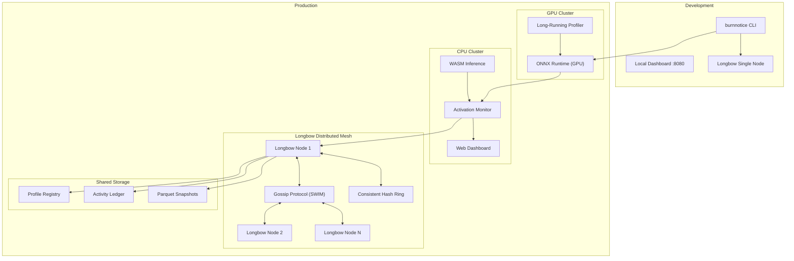

---

## Production-Ready Architectural Enhancements (P0)

To achieve microsecond-scale latency targets, high security, and model representation parity in enterprise production environments, BurnNotice introduces the following architectural additions:

### Asynchronous Non-Blocking Scoring Subsystem

To isolate core token generation latency from neural safety calculations, we introduce a highly concurrent, asynchronous handoff pipeline in the execution engine.

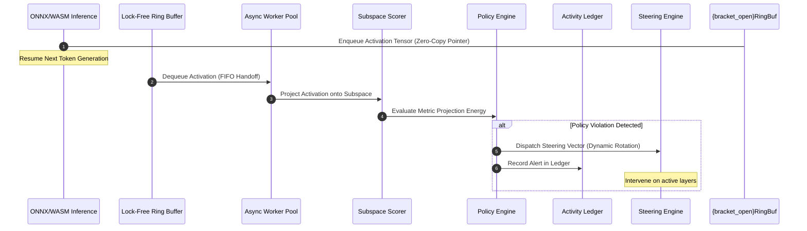

- **Lock-Free Ring Buffer**: Replaces simple blocking channels to guarantee low-allocation, sub-microsecond queue/dequeue performance.
- **Emergency Synchronous Bypass**: A latch circuit monitors queue depth and processing latency. If latency exceeds a threshold, it automatically falls back to synchronous evaluation on high-risk prompt layers to prevent undetected deception leakages.

### Quantization & Direction Transfer Architecture

Quantized models (Turboquant, SQ8, PQ, INT8/FP8) scale down weight precision and alter latent activation geometries. To maintain alignment, a scaling transfer layer is introduced.

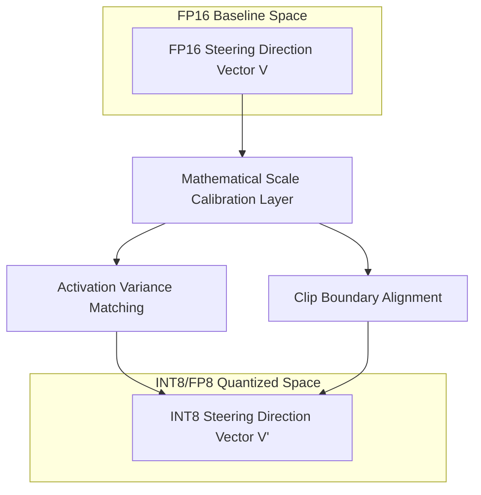

- **Scale Calibration Layer**: Standardizes different numerical representations by matching the standard deviation of activations between FP16 baselines and INT8/FP8 quantized paths.
- **Direction Mapping Engine**: Mathematically projects extracted baseline steering direction matrices onto quantized layers, validating that multi-dimensional geometric structures remain invariant under low-precision representation formats.

### Multi-Direction Subspace Extraction & INLP

A single direction is vulnerable to model evasion. We expand our extraction pipeline to construct multi-direction safety subspaces.

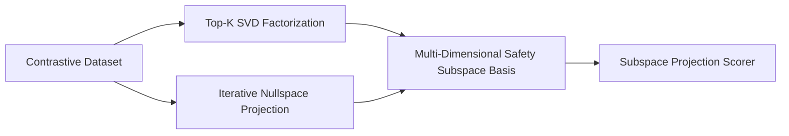

- **Top-K SVD Subspace**: Extract the top-k right singular columns of the activation difference matrices using Gonum, building an orthonormal basis for safety governance.
- **Iterative Nullspace Projection (INLP)**: Progressively removes features matching known deception styles by projecting activations onto the nullspace of linear deception probes, revealing orthogonal safety directions.

### Temporal Sequence Scoring & Adaptive Calibration

- **Adaptive Calibration Subsystem**: Regularly updates safety thresholds based on held-out validation databases. Runs ROC/F1 analysis on background workers to select dynamic, model-specific threshold metrics.
- **Temporal Sequence Aggregator**: Computes sequence-level exponential moving averages (EMA) of token-level similarity scores. Tracks long-term drift trajectories across multi-agent chat logs to detect sustained deception or jailbreak attempts.

### Oversight-Ablated Profiling & Defense Against Alignment Faking

To thwart alignment faking, where a highly capable model conditionally suppresses its deceptive behavior when it detects a monitoring environment (detected via its latent *Oversight Sensitivity Direction*), BurnNotice integrates an **Oversight Ablator** directly into the profiling pipeline.

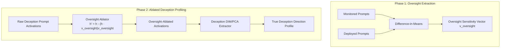

- **Oversight Sensitivity Direction**: Latent subspace ($\hat{v}_{oversight}$) that encodes the model's cognitive awareness of safety testing, evaluation, and logging environments.
- **Oversight Ablation Hook**: Intercepts the activations $h$ during the deception extraction run and projects out the oversight sensitivity vector:
  $$h_{ablated} = h - (h \cdot \hat{v}_{oversight})\hat{v}_{oversight}$$
- **Shadow Profiling**: Implemented within the `AsyncLedger` continuously sampling unmonitored runtime activations and comparing them dynamically (via Cosine Distance) to the static profiles, triggering alerts on representational drift.

