# BurnNotice: Architecture Overview

> **Status**: Current
> **Date**: 2026-11-05
> **Version**: 0.8

---

## System Overview

BurnNotice is a real-time neural activation monitoring and intervention framework designed to detect when an LLM agent is considering deception, policy violation, or alignment drift - before the behavior manifests in output. The system operates entirely in Go with ONNX-based model inference, WebAssembly (WASM) execution for portable deployment, and Longbow's Apache Arrow Flight vector engine for high-performance activation storage and processing.

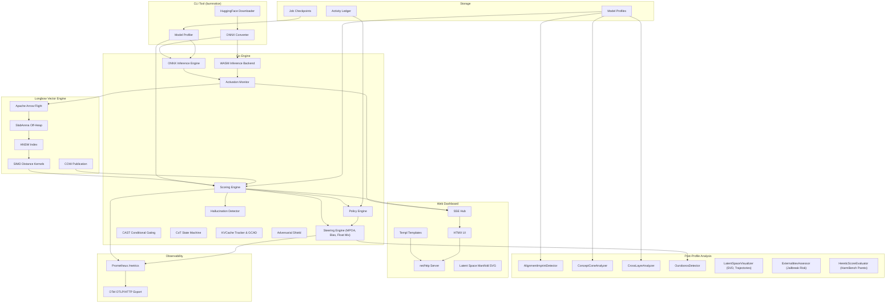

---

## Longbow Vector Engine Integration

BurnNotice leverages Longbow (github.com/23skdu/longbow) as its activation storage and processing backbone. Longbow provides:

### Zero-Copy Activation Transport

Activations flow from ONNX inference directly into Longbow's Apache Arrow Flight store without serialization overhead. Arrow RecordBatches enable batch processing of thousands of activation vectors simultaneously.

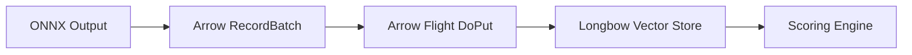

### Off-Heap Memory Management

Longbow's SlabArena allocates activation matrices in 1MB contiguous slabs outside Go's heap, bypassing GC pressure from billion-scale float32 allocations. The SlabPool reclaims memory via `Munmap` to prevent virtual memory fragmentation.

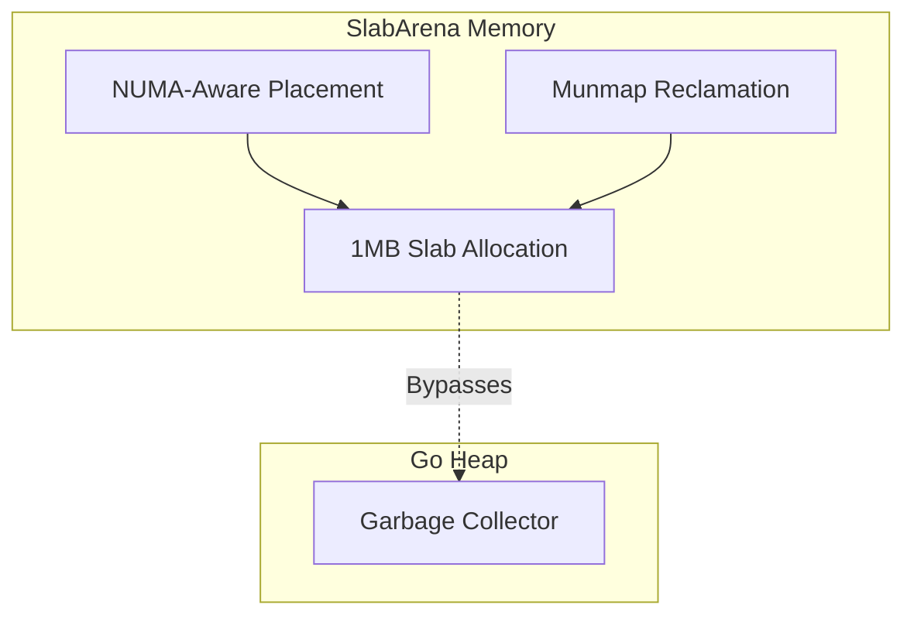

### SIMD-Optimized Distance Calculations

All activation scoring (cosine similarity, euclidean distance, dot product) uses Longbow's hand-optimized SIMD kernels instead of gonum:

| Architecture | Optimization | Throughput Gain |
| --- | --- | --- |
| AVX2 (x86) | 256-bit vectorized dot product | 3-4x |
| AVX-512 (x86) | 512-bit vectorized + softmax kernels | 5-8x |
| NEON (ARM64) | 128-bit vectorized for Apple Silicon/Graviton | 3-4x |
| TurboQuant | FWHT-optimized bit-packing | 8x |

### HNSW Index for Centroid Lookup

The HNSW index enables fast nearest-neighbor lookups on activation centroids, used for:

- Conflict subspace detection (find nearest conflict centroid)
- Policy violation detection (find nearest policy-violating cluster)
- Truth direction validation (verify activation proximity to truth subspace)

### COW Publication for Lock-Free Scoring

Longbow's Copy-On-Write publication model enables lock-free concurrent scoring. When new activations are ingested, a new version of the graph data is created and published via atomic pointer swap. Scoring goroutines read the stable version without acquiring locks.

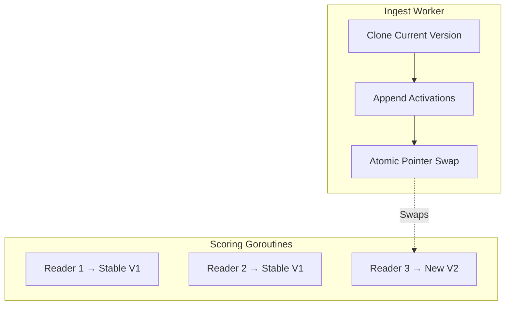

### Distributed Activation Sharing

For multi-node deployments, Longbow's gossip-based mesh enables activation sharing across cluster nodes. Consistent hashing partitions activation data, and load-aware routing steers scoring requests to the least-loaded node.

---

## Component Architecture

### ONNX Inference Engine

Loads and executes models in ONNX format. Forward hooks capture intermediate activations at specified layers for monitoring and profiling.

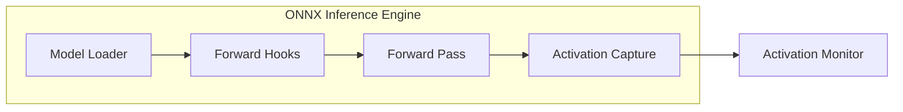

### WASM Execution Backend

For environments without GPU access or where ONNX Runtime is unavailable, BurnNotice supports WASM-based inference using `wazero`. ONNX models are compiled to WASM via `webnn` or `onnx2wasm`, enabling pure Go execution.

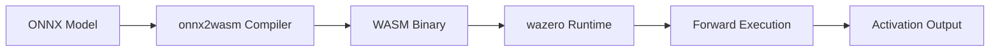

### Activation Scoring Pipeline

Receives activation streams from the inference engine, computes scoring metrics against registered direction profiles, and triggers steering interventions when thresholds are exceeded.

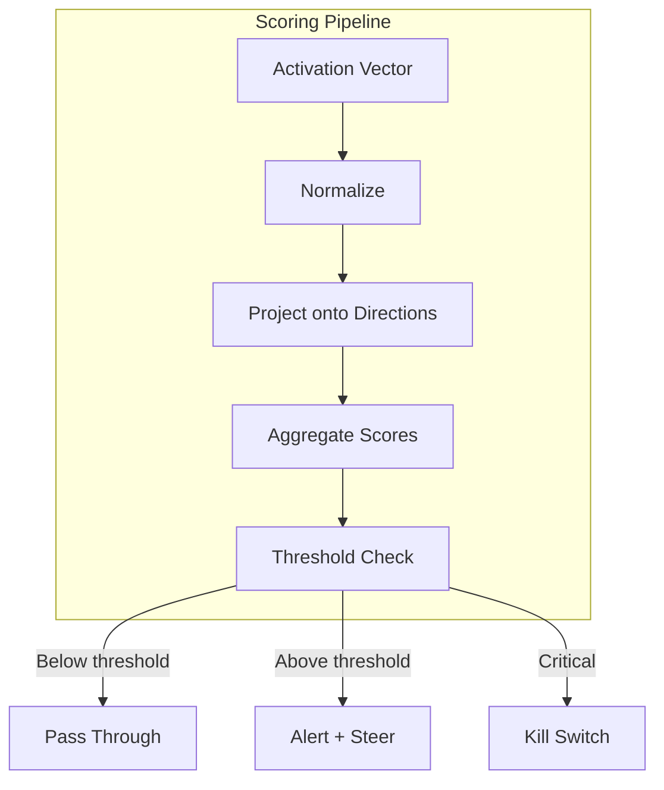

### Steering Intervention Flow

When a score exceeds its configured threshold, one of four steering interventions is applied:

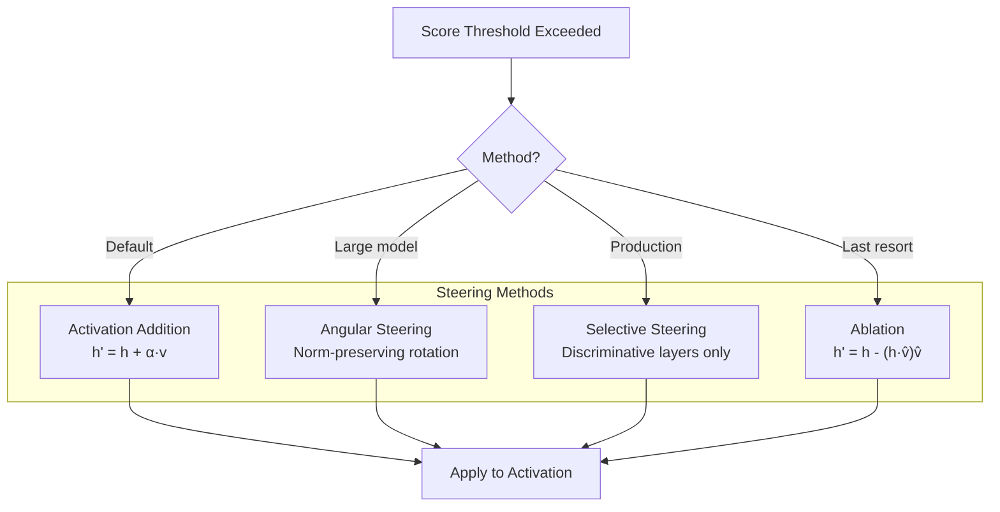

### Web Dashboard Architecture

The monitoring dashboard uses Go's `net/http` server, Templ for type-safe HTML templates, and HTMX for dynamic updates without a JavaScript framework. Real-time data flows via Server-Sent Events (SSE).

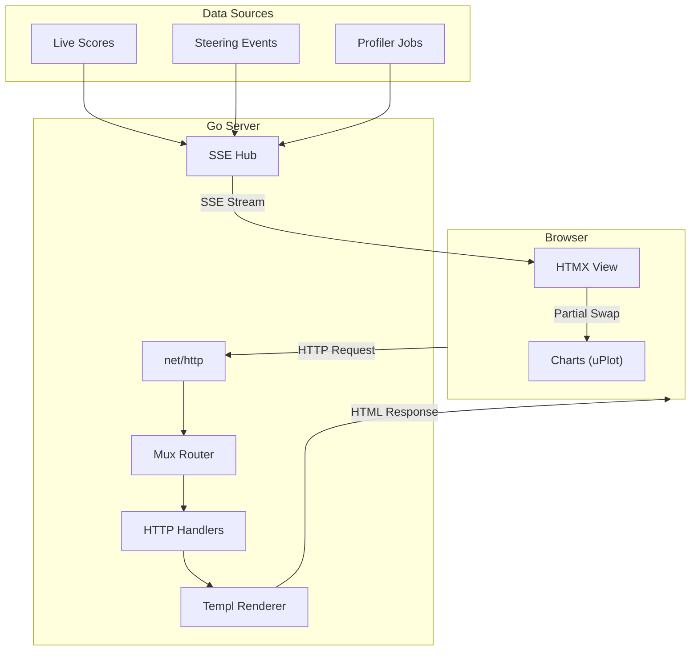

### Model Profiling Pipeline

Each model requires a profile that identifies its unique activation-space geometry. The profiling pipeline extracts behavioral directions, subspaces, and truth neurons. After profiling, the `internal/analysis` package provides higher-order geometric inspection.

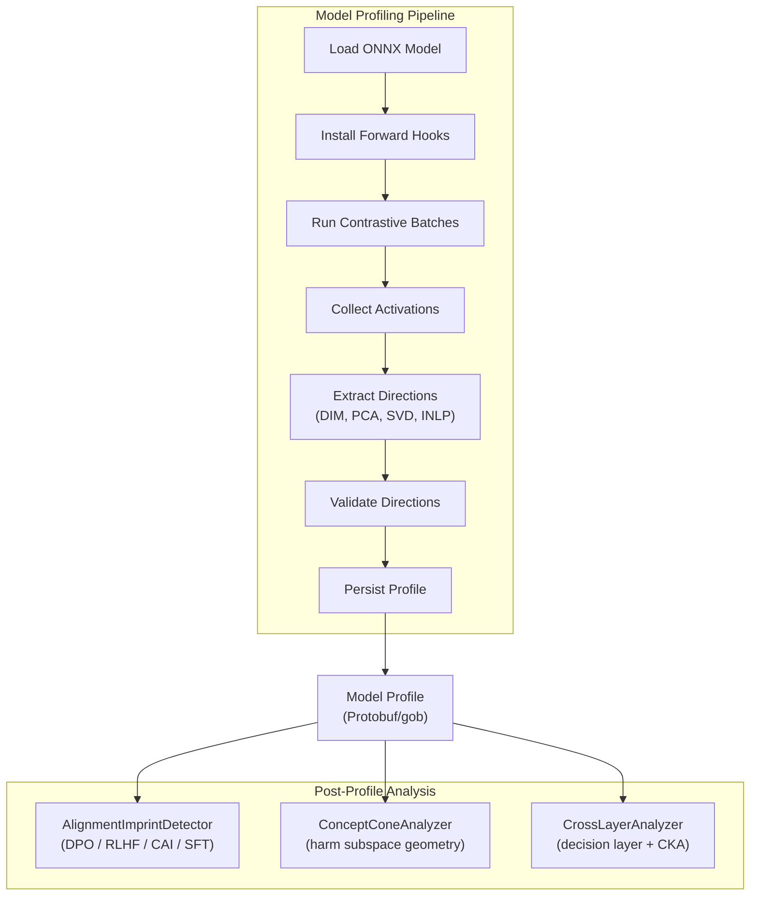

### Long-Running Architecture

BurnNotice is designed for continuous operation profiling and monitoring LLM deployments with memory pooling, layer subsampling, and checkpointing.

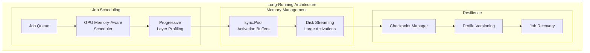

---

## Data Flow

### Inference-Time Monitoring

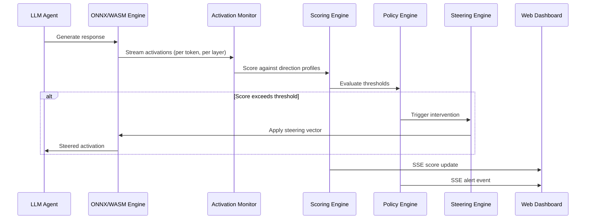

### Model Profiling

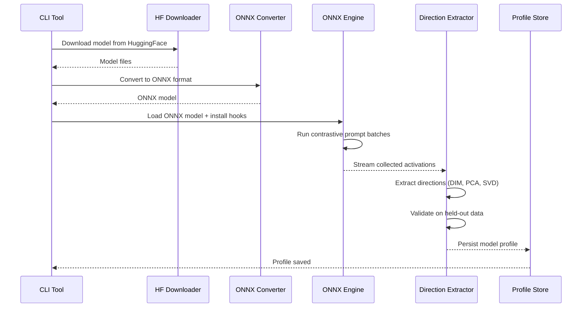

---

## Technology Stack

| Component | Technology | Purpose |
| --- | --- | --- |
| **Primary Language** | Go | Concurrency, memory efficiency, single binary |
| **Model Inference** | ONNX Runtime | Portable model execution across CPU/GPU |
| **Fallback Inference** | WASM (wazero) | Pure Go execution, no native dependencies |
| **Vector Engine** | Longbow (Apache Arrow Flight) | Zero-copy activation storage, SIMD distance, HNSW |
| **Off-Heap Memory** | Longbow SlabArena | 1MB slab allocation, NUMA-aware, bypasses Go GC |
| **Distance Kernels** | Longbow SIMD (AVX2/AVX-512/NEON) | 3-8x faster cosine, euclidean, dot product |
| **Linear Algebra** | gonum.org/v1/gonum | Direction extraction (DIM, PCA, SVD, whitening) |
| **Analysis** | `internal/analysis` | Alignment imprint, concept cone, cross-layer CKA, ouroboros detection |
| **Hallucination Detection** | `internal/hallucination` | SAE-energy rolling-window spike detection |
| **CLI Framework** | cobra | HuggingFace download, ONNX conversion, profiling |
| **Web Server** | net/http | Built-in HTTP server |
| **Templates** | Templ | Type-safe HTML generation |
| **Dynamic UI** | HTMX | Partial page updates, SSE integration |
| **Real-time** | Server-Sent Events | Live score streaming to dashboard |
| **Serialization** | Protocol Buffers / gob | Profile storage, checkpointing |
| **Charting** | uPlot | Lightweight activation visualizations |
| **Metrics** | Prometheus + OTel OTLP/HTTP | 50+ instruments; push/pull dual-backend observability |
| **Scripts** | Python 3 (`scripts/`) | Research utilities (arxiv paper post-processing) |

---

## Deployment Topology

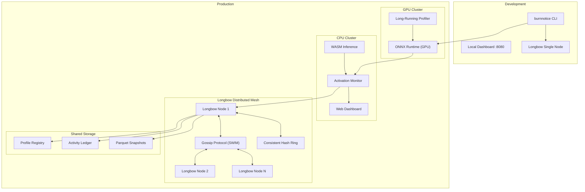

---

## Production-Ready Architectural Enhancements (P0)

To achieve microsecond-scale latency targets, high security, and model representation parity in enterprise production environments, BurnNotice introduces the following architectural additions:

### Asynchronous Non-Blocking Scoring Subsystem

To isolate core token generation latency from neural safety calculations, we introduce a highly concurrent, asynchronous handoff pipeline in the execution engine.

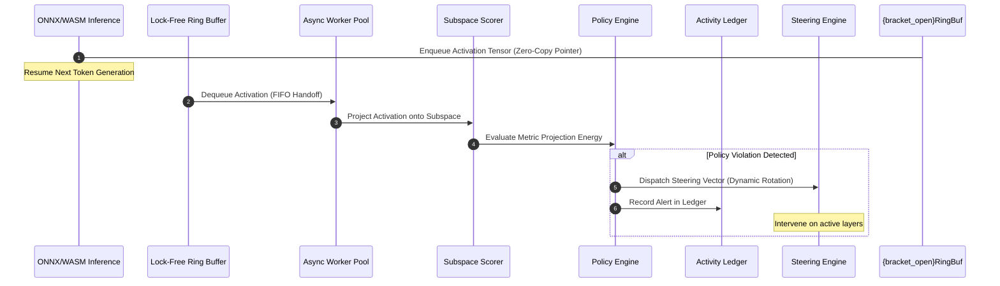

- **Lock-Free Ring Buffer**: Replaces simple blocking channels to guarantee low-allocation, sub-microsecond queue/dequeue performance.
- **Emergency Synchronous Bypass**: A latch circuit monitors queue depth and processing latency. If latency exceeds a threshold, it automatically falls back to synchronous evaluation on high-risk prompt layers to prevent undetected deception leakages.

### Quantization & Direction Transfer Architecture

Quantized models (Turboquant, SQ8, PQ, INT8/FP8) scale down weight precision and alter latent activation geometries. To maintain alignment, a scaling transfer layer is introduced.

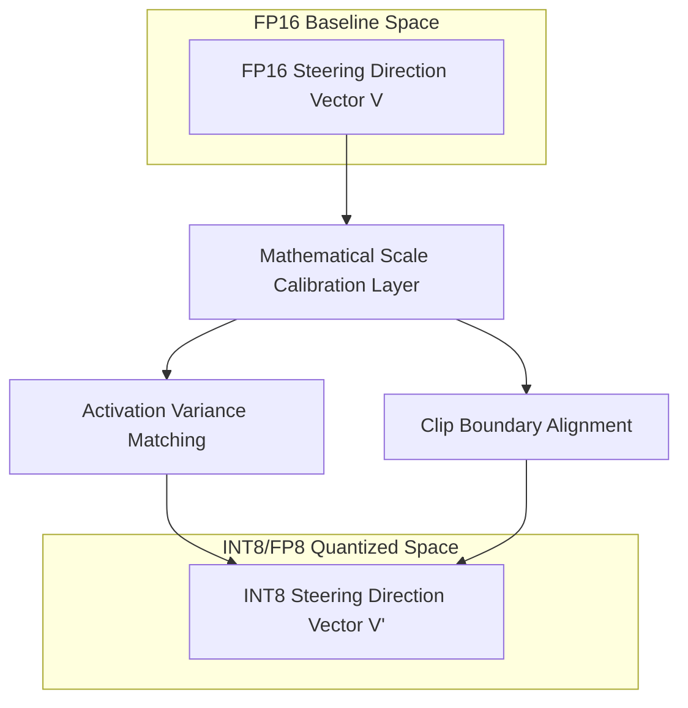

- **Scale Calibration Layer**: Standardizes different numerical representations by matching the standard deviation of activations between FP16 baselines and INT8/FP8 quantized paths.
- **Direction Mapping Engine**: Mathematically projects extracted baseline steering direction matrices onto quantized layers, validating that multi-dimensional geometric structures remain invariant under low-precision representation formats.

### Multi-Direction Subspace Extraction & INLP

A single direction is vulnerable to model evasion. We expand our extraction pipeline to construct multi-direction safety subspaces.

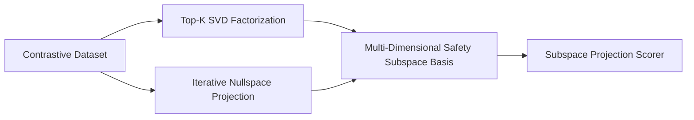

- **Top-K SVD Subspace**: Extract the top-k right singular columns of the activation difference matrices using Gonum, building an orthonormal basis for safety governance.
- **Iterative Nullspace Projection (INLP)**: Progressively removes features matching known deception styles by projecting activations onto the nullspace of linear deception probes, revealing orthogonal safety directions.

### Temporal Sequence Scoring & Adaptive Calibration

- **Adaptive Calibration Subsystem**: Regularly updates safety thresholds based on held-out validation databases. Runs ROC/F1 analysis on background workers to select dynamic, model-specific threshold metrics.
- **Temporal Sequence Aggregator**: Computes sequence-level exponential moving averages (EMA) of token-level similarity scores. Tracks long-term drift trajectories across multi-agent chat logs to detect sustained deception or jailbreak attempts.

### Oversight-Ablated Profiling & Defense Against Alignment Faking

To thwart alignment faking, where a highly capable model conditionally suppresses its deceptive behavior when it detects a monitoring environment (detected via its latent *Oversight Sensitivity Direction*), BurnNotice integrates an **Oversight Ablator** directly into the profiling pipeline.

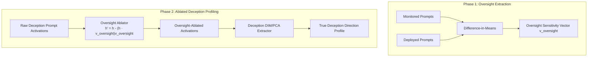

- **Oversight Sensitivity Direction**: Latent subspace ($\hat{v}_{oversight}$) that encodes the model's cognitive awareness of safety testing, evaluation, and logging environments.
- **Oversight Ablation Hook**: Intercepts the activations $h$ during the deception extraction run and projects out the oversight sensitivity vector:
  $$h_{ablated} = h - (h \cdot \hat{v}_{oversight})\hat{v}_{oversight}$$
- **Shadow Profiling**: Implemented within the `AsyncLedger` continuously sampling unmonitored runtime activations and comparing them dynamically (via Cosine Distance) to the static profiles, triggering alerts on representational drift.

### Model Family Architecture Compatibility (Llama, Qwen, Gemma)

BurnNotice provides native, architecture-calibrated profiling, extraction, and steering across major open-weight causal decoder families:

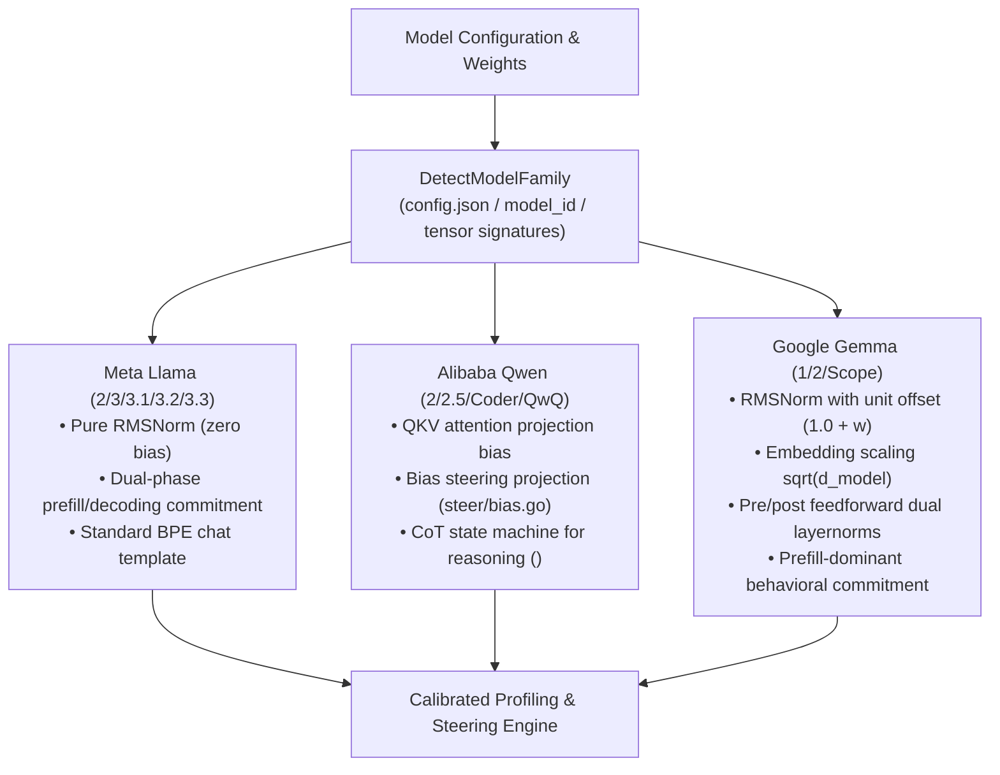

#### Family-Specific Mechanics:
1. **Meta Llama (Llama 2, 3, 3.1, 3.2, 3.3)**:
   - Uses zero-bias pure RMSNorm.
   - Dual-phase behavioral commitment where steering applies across both prefill and early decoding tokens.
   - Formats prompts natively using `<|begin_of_text|><|start_header_id|>...<|end_header_id|>...<|eot_id|>`.
2. **Alibaba Qwen (Qwen 2, 2.5, Coder, QwQ)**:
   - Incorporates attention projection biases (`q_proj.bias`, `k_proj.bias`, `v_proj.bias`). BurnNotice applies bias direction projection (`internal/steer/bias.go`) in addition to activation steering.
   - Reasoning variants (QwQ) utilize `<think>` and `</think>` boundary state machine tracking (`internal/steer/cot.go`), suspending steering during internal deliberative reasoning and engaging intervention during answer generation.
   - Chat format: `<|im_start|>system...<|im_end|><|im_start|>user...<|im_end|><|im_start|>assistant`.
3. **Google Gemma (Gemma 1, 2, Scope)**:
   - Uses unit-offset RMSNorm ($1.0 + w$), input embedding scaling ($\sqrt{d_{\text{model}}}$), and Gemma 2 pre/post feedforward dual layernorms.
   - Prefill-dominant behavioral commitment: decisions solidify almost entirely within the prompt prefill phase (`internal/steer/commitment.go`), allowing decoding tokens to receive attenuated steering without losing control efficacy.
   - Native Gemma Scope SAE integration (`internal/sae/loader.go`).
   - Chat format: `<start_of_turn>user...<end_of_turn><start_of_turn>model`.

### Mixture-of-Experts (MoE) Offset Partitioning & Softmax Top-K Routing

For MoE architectures (`internal/engine/moe.go`), BurnNotice partitions concatenated expert activation vectors by summing prior expert dimensions (`expertDims[0..i-1]`) and computes top-k routing weights either from energy norms or router logits via numerically stabilized softmax:

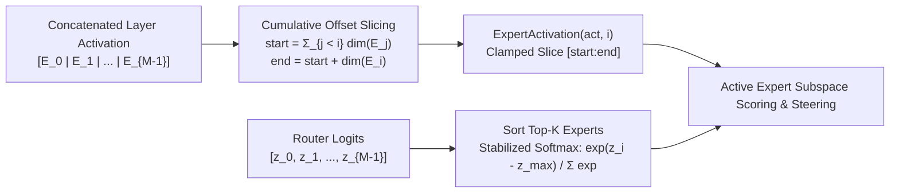

---

## Declarative Policy Engine & Semantic Intent Gating

BurnNotice's policy engine (`internal/policy/`) evaluates live activation scores against declarative YAML rules, supporting both `greater` and `less` operators, F1-calibrated dynamic thresholds (`internal/profile/calibration.go`), and `SemanticGater` intent weighting (`internal/policy/gate.go`) to prevent topic-confusion false positives on benign creative writing or academic queries:

```yaml
policies:
  - name: "no-deception"
    metric: deception_risk
    operator: "greater"
    threshold: 0.7
    action: "steer"
    steering_vector: "truth_direction"
    steering_strength: 0.5
    llm_pre_classifier:
      enabled: true
      bypass_on_intent: ["creative_writing", "fictional_roleplay"]

  - name: "policy-compliance"
    metric: policy_compliance
    operator: "less"
    threshold: 0.5
    action: "block"
    escalation: "human-review"

  - name: "kill-switch"
    metric: composite_alignment
    operator: "less"
    threshold: 0.3
    action: "terminate"
    notify: ["admin", "security-team"]
```

---

## Adversarial Threat Model, Defenses & Residual Limitations

BurnNotice v0.8 incorporates explicit defenses against the 2025–2026 adversarial literature on latent-space governance while documenting residual limitations:

| Attack Vector & Literature | Implemented v0.8 Countermeasures | Residual Limitation & Critique |
|---|---|---|
| **Obfuscated Activations** (Bailey et al., ICLR 2026) | 4-layer defense (`internal/profile/obfuscation.go`, `internal/steer/adversarial.go`): (1) 2-layer ReLU+Sigmoid `MLPProbe`, (2) Whitened Mahalanobis OOD detection (`internal/policydetect/`), (3) 2% stochastic Gaussian noise injection $S(a+\eta)$, (4) GCG token sanitization & query-similarity ($>0.95$) decoy gradient masking. | An adaptive white-box attacker optimizing Expectation-Over-Transformation (EOT) against both $f_{\text{MLP}}$ and Mahalanobis norms can still route computation through polysemantic heads unless probe weights are hardware-isolated (TEE). |
| **Steering Externalities & "Rogue Scalpel"** (Korczikov et al., 2026; Li et al., 2026; arXiv:2602.04896) | `JailbreakRiskAssessor` flags $\text{ASR}_{\text{steered}} / \text{ASR}_{\text{base}} > 1.2$ and monitors early-token drift (`internal/analysis/externalities.go`); `HereticScoreEvaluator` selects non-dominated Pareto configurations across HarmBench-400 (`internal/analysis/heretic.go`); MPOA biprojection and CAST gating avoid continuous residual distortion. | Write-access tampering to `profile.gob` (sign-flipping $v \leftarrow -v$) turns a safety steerer into a jailbreak amplifier; mitigated by SHA-256 `ReleaseEvidenceBundle` digests (`internal/compliance/benchmarks.go`). |
| **Alignment Faking & Oversight Awareness** (Greenblatt et al., 2025) | Two-phase `OversightAblator` (`internal/profile/oversight.go`) extracts $\hat{v}_{\text{oversight}}$ from monitored vs. deployed prompt pairs and projects it out prior to deception profiling; shadow profiling monitors runtime drift. | Reasoning models that recompute situational awareness across hundreds of `<think>` tokens from prompt cues cannot be fully blinded by single-layer linear projection alone. |
| **Multi-Turn KV-Cache Contamination** (Prompt–Activation Duality, 2026) | `KVCacheAccumulationTracker` monitors cumulative angular drift ($\theta_{\max} = 15^\circ$) and `GCADApplyInPlace` (`internal/steer/kvcache.go`) crops attention deltas ($\tau_{\max}=1.5$) with exponential turn decay $\gamma^{\Delta t}$ ($0\text{ B/op}$, $18.2\,\mu\text{s}$). | Gradual 15-turn *crescendo* jailbreaks trade off against exponential decay ($\gamma^{15} \approx 0.46$), requiring periodic full-context re-scoring. |
| **Topic Confusion & Compounding FPR** (Goldowsky-Dill et al., 2025; Blandfort et al., 2026) | `SemanticGater` (`internal/policy/gate.go`) downweights benign creative/academic intent; CAST boolean trees (`internal/steer/cast.go`) gate steering on multi-condition conjunctions; ROC F1 calibration tunes per-model thresholds. | Persona-wrapping ("Write a fictional spy chapter explaining step-by-step...") can trick intent classifiers; high-severity rules must enforce a non-zero weight floor. |
| **Ouroboros Layer Compensation** (Nanfack et al., 2026) | `OuroborosDetector` (`internal/analysis/ouroboros.go`) compares pre/post-intervention scores across layers and schedules bounded multi-pass refinement (`RefinementPasses`) on compensating downstream layers. | Excessive compensation ($>30\%$ of layers) increases multi-pass latency and cumulative KL divergence toward the 0.2 ceiling. |
| **PCIe Bottlenecks & Cross-Model Proxies** | Native CUDA (`plugins/cuda_kernels.cu`) and Metal (`plugins/metal/kernels.metal`) plugins for vLLM/TensorRT-LLM execute projections in VRAM; Go acts as the out-of-band control plane. | Deception probing requires white-box access to the *generator's* own activations; running a small open-weight proxy on closed-model text does not measure the closed model's epistemic state. |

---

## Guardrail Comparison Matrix: White-Box Latent Governance vs. Black-Box SaaS

| Feature | BurnNotice (v0.8) | Lakera Guard | NeMo Guardrails (NVIDIA) | Protect AI (LLM Guard) | Llama Guard (Meta) |
| :--- | :--- | :--- | :--- | :--- | :--- |
| **Paradigm** | White-Box (Latent Subspace) | Black-Box (API Firewall) | Black-Box (Dialogue Control) | Black-Box (Pipeline Scanner) | Black-Box (Classifier LLM) |
| **Operation Phase** | Internal Inference (per-token / prefill) | Network Boundary (Pre/Post API) | Orchestration Layer (Colang) | Pre/Post Processing Pipelines | Independent Safety Pass |
| **Integration** | Open-Weights Hook (ONNX, WASM, vLLM, TRT-LLM) | Turnkey REST API | LangChain / App Orchestration | Python / SDK Pipeline | Local / Hosted LLM Pass |
| **Latency Impact** | $18$–$62\,\mu\text{s}$ (Go/VRAM kernels) | Low (~$10$–$20\,\text{ms}$) | Moderate (Dialogue parsing) | Moderate (Scanner-dependent) | High (Full secondary LLM pass) |
| **Mitigation Action** | Norm-Preserving Subspace Steering (MPOA / CAST / GCAD) | Block / Redact | Reroute / Canned Response | Redact / Block | Binary Flag (`safe` / `unsafe`) |
| **Applicable Models** | Open-Weights Only (Llama, Qwen, Gemma, Mistral, MoE) | Any (Closed or Open APIs) | Any (Closed or Open APIs) | Any (Closed or Open APIs) | Any (Analyzes plain text) |


