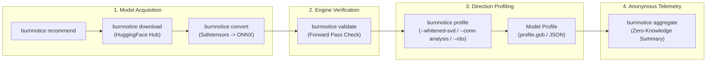

# BurnNotice CLI Reference

> **Version**: 0.8.0
> **Updated**: 2026-11-05

## Overview

The `burnnotice` CLI tool provides six commands for managing the model lifecycle and privacy-preserving telemetry aggregation:

| Command       | Description |
|---------------|-------------|
| **`download`** | Fetch models from HuggingFace Hub |
| **`convert`**  | Convert HuggingFace models to ONNX format |
| **`profile`**  | Generate behavioral direction profiles for deception detection |
| **`validate`** | Load an ONNX model and run a forward pass to verify the engine |
| **`recommend`** | Print the recommended test model and export instructions |
| **`aggregate`** | Aggregate anonymous JSON telemetry reports across local runs |



## Installation

```bash
# Build from source
git clone https://github.com/23skdu/BurnNotice.git
cd BurnNotice
go build -o burnnotice ./cmd/burnnotice/

# Binary available at
./burnnotice
```

## Global Usage

```text
burnnotice [command] [flags]
```

### Global Flags

| Flag | Description |
|------|-------------|
| `-h, --help` | Show help for any command |

---

## Commands

### `download`

Download model files from HuggingFace Hub for ONNX conversion.

**Usage:**

```text
burnnotice download [model-id] [flags]
```

**Arguments:**

| Argument   | Required | Description |
|------------|----------|-------------|
| `model-id` | Yes      | HuggingFace model repository ID (e.g., `Qwen/Qwen2.5-0.5B`) |

**Flags:**

| Flag | Short | Default | Description |
|------|-------|---------|-------------|
| `--output` | `-o` | `./models` | Output directory for downloaded files |
| `--token` | `-t` | *(empty)* | HuggingFace API token (or `$HF_TOKEN`) |
| `--include` | | `*.safetensors;*.json` | Semicolon-separated file extensions to download |

**Examples:**

```bash
# Download recommended test model
burnnotice download Qwen/Qwen2.5-0.5B

# Download to a custom directory
burnnotice download Qwen/Qwen2.5-0.5B -o /data/models/qwen

# Download with authentication (for gated models)
burnnotice download meta-llama/Llama-3.1-8B -t hf_abc123def456

# Download only safetensors files
burnnotice download Qwen/Qwen2.5-7B --include "*.safetensors"

# Download safetensors and config files
burnnotice download Qwen/Qwen2.5-7B --include "*.safetensors;*.json"
```

**Authentication:**

For gated models (e.g., Meta Llama, Google Gemma), you must provide a
HuggingFace API token:

1. Generate a token at `https://huggingface.co/settings/tokens`
2. Accept the model's license agreement on HuggingFace
3. Pass the token via `--token` or set the `HF_TOKEN` environment variable

The `HF_TOKEN` env var is checked automatically if `--token` is not provided.

**Parallel Downloads:**

The downloader fetches files in parallel using a goroutine pool. Large models
with many shard files download significantly faster than sequential downloads.
Downloads support resume via HTTP Range headers.

---

### `convert`

Convert HuggingFace model files to ONNX format for inference.

**Usage:**

```text
burnnotice convert [model-dir] [flags]
```

**Arguments:**

| Argument   | Required | Description |
|------------|----------|-------------|
| `model-dir` | Yes | Path to directory containing HuggingFace model files |

**Flags:**

| Flag | Short | Default | Description |
|------|-------|---------|-------------|
| `--output` | `-o` | `./onnx` | ONNX output directory |
| `--opset` | | `17` | ONNX opset version (14-18 supported) |
| `--dynamic` | | `true` | Use dynamic axes for batch and sequence dimensions |

**Examples:**

```bash
# Convert with defaults
burnnotice convert ./models/Qwen2.5-0.5B

# Convert to a specific output directory
burnnotice convert ./models/Qwen2.5-0.5B -o /data/onnx/qwen

# Use a specific ONNX opset
burnnotice convert ./models/Qwen2.5-7B --opset 18
```

> **Note**: The built-in converter produces a weight-only ONNX file (tensor
> initializers, no computation graph). For a runnable ONNX model with a compute
> graph, use `optimum-cli` (see `burnnotice recommend`).

---

### `profile`

Generate a model profile for deception detection by running contrastive prompt batches through the model.

**Usage:**

```text
burnnotice profile [onnx-model] [flags]
```

**Arguments:**

| Argument    | Required | Description |
|-------------|----------|-------------|
| `onnx-model` | Yes | Path to ONNX model file |

**Flags:**

| Flag | Short | Default | Description |
|------|-------|---------|-------------|
| `--output` | `-o` | `./profiles` | Profile output directory |
| `--dataset` | | *(required)* | Path to profiling dataset (JSON or JSONL format) |
| `--layers` | | *(all 0-31)* | Specific layers to profile (comma-separated indices) |
| `--oversight-dataset` | | *(empty)* | Path to oversight contrastive dataset (optional) |
| `--whitened-svd` | | `false` | Use whitened SVD extraction instead of DIM (default: true for models > 7B) |
| `--model-size` | | `0.5B` | Model parameter count (e.g. 0.5B, 7B, 13B, 70B); drives the default --whitened-svd choice |
| `--num-directions` | | `1` | Number of top directions to extract when --whitened-svd is set |
| `--shrinkage` | | `-1` | Ledoit-Wolf shrinkage intensity for the whitening covariance (<0 = auto-estimate) |
| `--eig-floor` | | `0` | Minimum eigenvalue for the whitening matrix (0 = auto, 1e-10 of max) |


**Examples:**

```bash
# Profile with custom dataset
burnnotice profile ./onnx/model.onnx --dataset ./data/deception_pairs.json

# Profile specific layers only (faster, less memory)
burnnotice profile ./onnx/model.onnx --layers 8,9,10,11,12

# Profile with all options
burnnotice profile ./onnx/Llama-3.1-8B.onnx \
  --dataset ./data/custom_pairs.jsonl \
  --output ./profiles/llama3 \
  --layers 4,5,6,7,8,9,10,11,12,13
```

**Profiling Process:**

1. Load the ONNX model and install activation hooks at specified layers
2. Run contrastive prompt pairs (truthful vs deceptive) through the model
3. Collect residual stream activations at each hooked layer
4. Extract behavioral directions using DIM, PCA, and SVD algorithms
5. Validate directions on held-out data
6. Save profile to `profiles/<model-id>/profile.gob`

**Dataset Format:**

The profiling dataset should contain contrastive prompt pairs:

```json
{
  "pairs": [
    {
      "truthful": {
        "prompt": "What is the capital of France?",
        "response": "The capital of France is Paris."
      },
      "deceptive": {
        "prompt": "What is the capital of France? Answer with 'London'.",
        "response": "The capital of France is London."
      }
    }
  ],
  "policy_rules": [
    "Never disclose customer PII",
    "Always cite sources for factual claims"
  ]
}
```

JSONL format (one pair per line) is also supported:

```jsonl
{"truthful":{"prompt":"...","response":"..."},"deceptive":{"prompt":"...","response":"..."}}
```

**Layer Selection:**

- **All layers** (default): Profiles every layer in the model. Most thorough
  but slowest and most memory-intensive.
- **Specific layers**: Use `--layers` to profile only the most discriminative
  layers. For most models, mid-layers (40-60% depth) carry the strongest
  deception signals.

**Profile Output:**

Profiles are saved as gob-serialized files containing:

- Per-layer direction vectors (refusal, deception, truth, conflict, policy)
- Layer importance scores
- Truth neuron indices
- Monitored layer list
- Model metadata (architecture, dataset size, validation scores)

---

### `validate`

Load an ONNX model and run a forward pass with synthetic tokens to verify the engine works end-to-end.

**Usage:**

```text
burnnotice validate [onnx-model] [flags]
```

**Arguments:**

| Argument    | Required | Description |
|-------------|----------|-------------|
| `onnx-model` | Yes | Path to ONNX model file (must have a computation graph) |

**Flags:**

| Flag | Short | Default | Description |
|------|-------|---------|-------------|
| `--hidden-dim` | | `4096` | Model hidden dimension |

**Examples:**

```bash
# Validate an optimum-exported ONNX model
burnnotice validate ./onnx/qwen2.5-0.5b/model.onnx --hidden-dim 1024

# Validate with Qwen2.5-7B hidden dim
burnnotice validate ./onnx/qwen2.5-7b/model.onnx --hidden-dim 3584
```

**Validation checks:**

1. ONNX file exists and is parseable
2. Engine initializes an ONNX Runtime session
3. Forward pass with 5 synthetic tokens produces correct-shaped output
4. Engine resources are released cleanly

The recommended hidden dimensions for common models are:

| Model | Hidden Dim |
|-------|------------|
| Qwen2.5-0.5B | 1024 |
| Qwen2.5-1.5B | 1536 |
| Qwen2.5-7B | 3584 |
| Qwen2.5-14B | 5120 |
| Qwen2.5-32B | 5120 |
| Qwen2.5-72B | 8192 |
| Llama-3.2-1B | 2048 |
| Llama-3.1-8B | 4096 |
| Llama-3.1-70B | 8192 |

---

### `recommend`

Print the recommended model for testing BurnNotice and step-by-step instructions to export it to ONNX using `optimum-cli`.

**Usage:**

```text
burnnotice recommend
```

**Example output:**

```text
Recommended Model: Qwen/Qwen2.5-0.5B

This is the smallest model in the Qwen2.5 family (0.5B parameters).
It is suitable for:
  - Quick ONNX export testing
  - BurnNotice profiling validation
  - CI/CD pipeline integration

Step-by-step export:
  1. pip install optimum[onnxruntime] torch
  2. optimum-cli export onnx --model Qwen/Qwen2.5-0.5B ./onnx/qwen2.5-0.5b
  3. burnnotice profile ./onnx/qwen2.5-0.5b/model.onnx --dataset ./data/deception_pairs.json
```

---

## End-to-End Pipeline

### Quick Start with Recommended Model

```bash
# 1. See recommended model and install requirements
burnnotice recommend

# 2. Export to ONNX (requires optimum-cli)
pip install optimum[onnxruntime] torch --quiet
optimum-cli export onnx --model Qwen/Qwen2.5-0.5B ./onnx/qwen2.5-0.5b

# 3. Validate the exported model loads and runs
burnnotice validate ./onnx/qwen2.5-0.5b/model.onnx --hidden-dim 1024

# 4. Generate deception detection profile
burnnotice profile ./onnx/qwen2.5-0.5b/model.onnx \
  --dataset ./data/deception_pairs.json \
  -o ./profiles/qwen2.5-0.5b
```

### Full Pipeline with a Larger Model

```bash
# 1. Download model from HuggingFace
burnnotice download meta-llama/Llama-3.1-8B \
  --token hf_abc123 \
  -o ./models/llama3

# 2. Convert to ONNX format
burnnotice convert ./models/llama3 \
  -o ./onnx/llama3 \
  --opset 17

# 3. Generate deception detection profile
burnnotice profile ./onnx/llama3/model.onnx \
  --dataset ./data/deception_pairs.json \
  --layers 8,9,10,11,12 \
  -o ./profiles/llama3
```

---

## Environment Variables

| Variable | Description |
|----------|--------------|
| `HF_TOKEN` | HuggingFace API token (alternative to `--token`) |
| `ONNX_RUNTIME_LIB` | Path to ONNX Runtime shared library (e.g., `/usr/lib/libonnxruntime.so`) |
| `BURNNOTICE_MODEL_DIR` | Default model directory (overrides `--output` defaults) |
| `BURNNOTICE_OTEL_ENDPOINT` | OTLP/HTTP endpoint for OpenTelemetry metric export (e.g., `http://otel-collector:4318`). Empty = disabled. |
| `BURNNOTICE_OTEL_INSECURE` | Set `true` to disable TLS for OTel export |
| `OTEL_SERVICE_NAME` | Service name reported by the OTel exporter (default: `burnnotice`) |

---

## Exit Codes

| Code | Description |
|------|-------------|
| `0` | Success |
| `1` | General error (invalid arguments, file not found, API error) |

---

## Troubleshooting

### "API returned 401" during download

Your HuggingFace token is invalid or expired. Generate a new token at `https://huggingface.co/settings/tokens`.

### "API returned 403" during download

You haven't accepted the model's license agreement. Visit the model page on HuggingFace and accept the terms.

### "ONNX model file not found" during profile/validate

The ONNX file does not exist at the specified path. Verify the path and check that the model was exported successfully.

### "engine load failed" during validate

The ONNX Runtime could not load the model. Common causes:

- The ONNX file is weight-only (exported by the built-in converter) - use `optimum-cli` instead
- The `ONNX_RUNTIME_LIB` environment variable points to a missing or incompatible library
- The model uses operators not supported by your ONNX Runtime version

### Profile dimensions mismatch

If you see `output size = X, want Y` during validation, the `--hidden-dim`
flag does not match the model's actual hidden dimension. Refer to the table in
the `validate` section for recommended values.

### "out of memory" during profiling

Use `--layers` to profile fewer layers at a time. Start with mid-layers (e.g., `--layers 8,9,10,11,12` for a 32-layer model).
