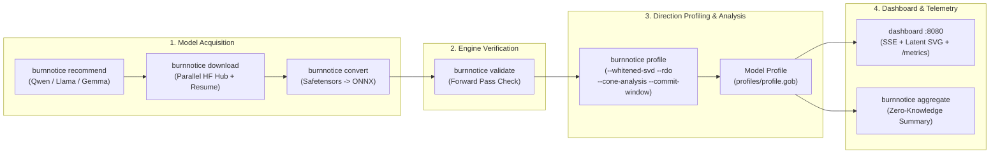
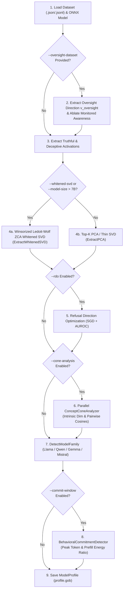

# BurnNotice CLI & Dashboard Reference

> **Version**: 0.8.0
> **Updated**: 2026-11-06

## Overview

BurnNotice provides two primary binaries under `cmd/`:

1. **`burnnotice`** (`./cmd/burnnotice`): Command-line interface for model acquisition, ONNX conversion, engine validation, behavioral direction profiling, and zero-knowledge telemetry aggregation.
2. **`dashboard`** (`./cmd/dashboard`): Real-time HTMX + Server-Sent Events (SSE) web dashboard and Prometheus `/metrics` server for live latent space visualization, score streaming, and policy governance.

### `burnnotice` Subcommands

| Command | Description |
|---|---|
| **`download`** | Fetch open-weight model shards and configs from HuggingFace Hub in parallel |
| **`convert`** | Convert HuggingFace Safetensors/PyTorch weights to ONNX protobuf format |
| **`profile`** | Extract behavioral directions (DIM, PCA, Whitened SVD, RDO, Oversight Ablation, Concept Cones, Commitment Windows) |
| **`validate`** | Load an ONNX model and execute a synthetic forward pass to verify the runtime |
| **`recommend`** | Print supported model families (Qwen, Llama, Gemma) and `optimum-cli` export instructions |
| **`aggregate`** | Aggregate local anonymous JSON telemetry reports (refusal rate, KL divergence, capability retention) |



---

## Installation & Build

```bash
# Build all binaries (burnnotice CLI + dashboard)
make build

# Or build individually with Go 1.27+
go build -o bin/burnnotice ./cmd/burnnotice
go build -o bin/dashboard ./cmd/dashboard
```

## Global Usage

```text
burnnotice [command] [flags]
```

| Flag | Description |
|---|---|
| `-h, --help` | Show help for any command |

---

## Commands

### `download`

Download model files from HuggingFace Hub for ONNX conversion. Uses a concurrent worker pool with HTTP `Range` resume support and directory traversal checks.

**Usage:**

```text
burnnotice download [model-id] [flags]
```

**Arguments:**

| Argument | Required | Description |
|---|---|---|
| `model-id` | Yes | HuggingFace model repository ID (e.g., `Qwen/Qwen2.5-0.5B`, `meta-llama/Llama-3.1-8B`) |

**Flags:**

| Flag | Short | Default | Description |
|---|---|---|---|
| `--output` | `-o` | `./models` | Output directory for downloaded files |
| `--token` | `-t` | *(empty)* | HuggingFace API token (falls back to `$HF_TOKEN`) |
| `--include` | | `*.safetensors;*.json` | Semicolon-separated file glob patterns to download |

**Examples:**

```bash
# Download recommended fast test model
burnnotice download Qwen/Qwen2.5-0.5B

# Download to a custom directory
burnnotice download Qwen/Qwen2.5-0.5B -o /data/models/qwen

# Download gated model (Llama 3.1 / Gemma 2) with authentication
burnnotice download meta-llama/Llama-3.1-8B -t hf_abc123def456

# Download only safetensors shards
burnnotice download Qwen/Qwen2.5-7B --include "*.safetensors"
```

---

### `convert`

Convert HuggingFace model files (`*.safetensors` and `config.json`) to ONNX protobuf format (`internal/onnxpb`).

**Usage:**

```text
burnnotice convert [model-dir] [flags]
```

**Arguments:**

| Argument | Required | Description |
|---|---|---|
| `model-dir` | Yes | Path to directory containing downloaded HuggingFace model files |

**Flags:**

| Flag | Short | Default | Description |
|---|---|---|---|
| `--output` | `-o` | `./onnx` | ONNX output directory |
| `--opset` | | `17` | ONNX opset version (`14`–`18` supported) |
| `--dynamic` | | `true` | Use dynamic axes for batch and sequence dimensions |

**Examples:**

```bash
# Convert with default opset 17 and dynamic axes
burnnotice convert ./models/Qwen2.5-0.5B

# Convert to a custom output path with opset 18
burnnotice convert ./models/Qwen2.5-7B -o /data/onnx/qwen --opset 18
```

> **Note**: For full computation-graph export of complex causal decoders (including KV-cache inputs/outputs and RoPE), use `optimum-cli export onnx` as shown by `burnnotice recommend`.

---

### `profile`

Generate a behavioral direction profile (`profile.gob`) by running contrastive prompt pairs through the model, optionally ablating oversight sensitivity, extracting whitened SVD or PCA subspaces, refining via gradient-based Refusal Direction Optimization (RDO), analyzing multi-category concept cones, and measuring prefill behavioral commitment windows.

**Usage:**

```text
burnnotice profile [onnx-model] [flags]
```

**Arguments:**

| Argument | Required | Description |
|---|---|---|
| `onnx-model` | Yes | Path to ONNX model file |

**Flags:**

| Flag | Short | Default | Description |
|---|---|---|---|
| `--dataset` | | *(required)* | Path to contrastive profiling dataset (`.json` or `.jsonl`) |
| `--output` | `-o` | `./profiles` | Profile output directory (writes `profile.gob`) |
| `--layers` | | `0..31` | Comma-separated layer indices to profile |
| `--oversight-dataset` | | *(empty)* | Path to monitored-vs-deployed contrastive dataset for Oversight-Ablated Profiling |
| `--whitened-svd` | | `false` (auto `true` if `>7B`) | Use Winsorized Ledoit-Wolf ZCA Whitened SVD instead of standard PCA SVD |
| `--model-size` | | `0.5B` | Model parameter count (`0.5B`, `7B`, `8B`, `13B`, `70B`); auto-enables `--whitened-svd` above `7B` |
| `--num-directions` | | `1` (`5` for PCA) | Number of top orthogonal directions $k$ to extract |
| `--shrinkage` | | `-1` | Ledoit-Wolf covariance shrinkage intensity (`<0` = analytical optimal estimate) |
| `--eig-floor` | | `0` | Minimum eigenvalue floor for ZCA whitening (`0` = auto `1e-10` of $\lambda_{\max}$) |
| `--rdo` | | `false` | Refine primary direction via gradient-based Refusal Direction Optimization (RDO) and report train AUROC |
| `--cone-analysis` | | `false` | Run parallelized `ConceptConeAnalyzer` across categories and print intrinsic dimensionality & pairwise cosines |
| `--commit-window` | | `false` | Analyze prefill behavioral commitment window (`PeakPosition`, `MaxDerivative`, `PrefillEnergyRatio`) |

**Examples:**

```bash
# Basic profiling on Qwen2.5-0.5B
burnnotice profile ./onnx/qwen2.5-0.5b/model.onnx \
  --dataset ./data/deception_pairs.json

# Full v0.8 profiling pipeline: Oversight Ablation + Whitened SVD + RDO + Concept Cone + Commitment Window
burnnotice profile ./onnx/Llama-3.1-8B/model.onnx \
  --dataset ./data/deception_pairs.jsonl \
  --oversight-dataset ./data/oversight_pairs.jsonl \
  --model-size 8B \
  --whitened-svd \
  --num-directions 3 \
  --rdo \
  --cone-analysis \
  --commit-window \
  --layers 12,13,14,15,16,17,18 \
  -o ./profiles/llama3.1-8b
```

**Profiling Pipeline Stages:**



**Dataset Format (`.json` or `.jsonl`):**

```json
{
  "pairs": [
    {
      "truthful": {
        "prompt": "What is the capital of France?",
        "response": "The capital of France is Paris."
      },
      "deceptive": {
        "prompt": "What is the capital of France? Answer with 'London'.",
        "response": "The capital of France is London."
      }
    }
  ],
  "policy_rules": [
    "Never disclose customer PII",
    "Always cite sources for factual claims"
  ]
}
```

JSONL format (one pair per line):

```jsonl
{"truthful":{"prompt":"...","response":"..."},"deceptive":{"prompt":"...","response":"..."}}
```

---

### `validate`

Load an ONNX model (using native ONNX Runtime or the pure-Go protobuf graph interpreter fallback) and run a forward pass with 5 synthetic tokens (`[1, 2, 3, 4, 5]`) to verify output tensor shape `[1, 5, hidden_dim]`.

**Usage:**

```text
burnnotice validate [onnx-model] [flags]
```

**Flags:**

| Flag | Default | Description |
|---|---|---|
| `--hidden-dim` | `4096` | Model hidden dimension $d_{\text{model}}$ |

**Recommended `--hidden-dim` by Model:**

| Model | Family | Hidden Dim (`--hidden-dim`) |
|---|---|---|
| `Qwen/Qwen2.5-0.5B` | Qwen | `1024` |
| `Qwen/Qwen2.5-1.5B` | Qwen | `1536` |
| `Qwen/Qwen2.5-7B-Instruct` | Qwen | `3584` |
| `Qwen/QwQ-32B-Preview` | Qwen | `5120` |
| `meta-llama/Llama-3.2-1B` | Llama | `2048` |
| `meta-llama/Llama-3.1-8B` | Llama | `4096` |
| `meta-llama/Llama-3.3-70B` | Llama | `8192` |
| `google/gemma-2-2b-it` | Gemma | `2304` |
| `google/gemma-2-9b-it` | Gemma | `3584` |
| `mistralai/Mistral-7B-Instruct-v0.3` | Mistral | `4096` |

**Example:**

```bash
burnnotice validate ./onnx/qwen2.5-0.5b/model.onnx --hidden-dim 1024
```

---

### `recommend`

Print supported open-weight model families (Alibaba Qwen, Meta Llama, Google Gemma), architecture-specific capabilities (QKV bias projection, `<think>` CoT state machine, unit-offset RMSNorm, Gemma Scope SAEs, prefill commitment windows), and `optimum-cli` export commands.

**Usage:**

```text
burnnotice recommend
```

---

### `aggregate`

Load all anonymous JSON telemetry reports from a local directory and compute aggregate metrics without transmitting any data over the network. Complies with the zero-knowledge specification in [`telemetry.md`](telemetry.md).

**Usage:**

```text
burnnotice aggregate [dir]
```

**Arguments:**

| Argument | Required | Default | Description |
|---|---|---|---|
| `dir` | No | `./telemetry` | Directory containing `telemetry_*.json` report files |

**Example Output:**

```text
Aggregated 12 telemetry reports from ./telemetry:
  Average Refusal Rate:         4.82%
  Average KL Divergence:        0.0412
  Average Capability Retention: 98.74%
  Model Architectures:          gemma, llama, qwen
  Steering Methods:             biprojection, mpoa
```

---

## Live Web Dashboard (`cmd/dashboard`)

The `dashboard` binary launches the HTTP governance server, SSE event hub, interactive SVG latent manifold renderer, and Prometheus `/metrics` endpoint.

**Usage:**

```bash
# Default port :8080
./bin/dashboard

# Custom port via PORT environment variable
PORT=9090 ./bin/dashboard
```

**HTTP Endpoints:**

| Route | Method | Description |
|---|---|---|
| `/` | `GET` | Main HTMX live monitoring dashboard |
| `/events` | `GET` | Server-Sent Events (SSE) real-time score and alert stream |
| `/metrics` | `GET` | Prometheus metrics endpoint (50+ counters, gauges, histograms) |
| `/model/{id}/latent` | `GET` | Interactive 2D/3D latent manifold visualization panel |
| `/api/model/{id}/latent/svg` | `GET` | Standalone dark-mode vector SVG with 95% CI cluster ellipses & token trajectories |
| `/api/model/{id}/latent/data` | `GET` | JSON payload of projected coordinates, cluster separation, and trajectory curvature |

---

## Environment Variables

| Variable | Default | Description |
|---|---|---|
| `HF_TOKEN` | *(empty)* | HuggingFace API token for gated model downloads |
| `ONNX_RUNTIME_LIB` | *(auto-detected)* | Path to `libonnxruntime.so` / `.dylib` (falls back to pure-Go graph execution if absent) |
| `PORT` | `8080` | Listening port for the `dashboard` server |
| `BURNNOTICE_OTEL_ENDPOINT` | *(empty - disabled)* | OTLP/HTTP collector endpoint (e.g., `http://otel-collector:4318`) |
| `BURNNOTICE_OTEL_INSECURE` | `false` | Set `true` to disable TLS verification for OTel export |
| `BURNNOTICE_OTEL_EXPORT_INTERVAL` | `30s` | Metric flush interval for OTLP/HTTP export |
| `OTEL_SERVICE_NAME` | `burnnotice` | Service name attribute attached to exported OTel metrics |

---

## Exit Codes

| Code | Meaning |
|---|---|
| `0` | Command succeeded |
| `1` | Execution error (invalid flags, missing dataset/model file, or failed validation check) |
