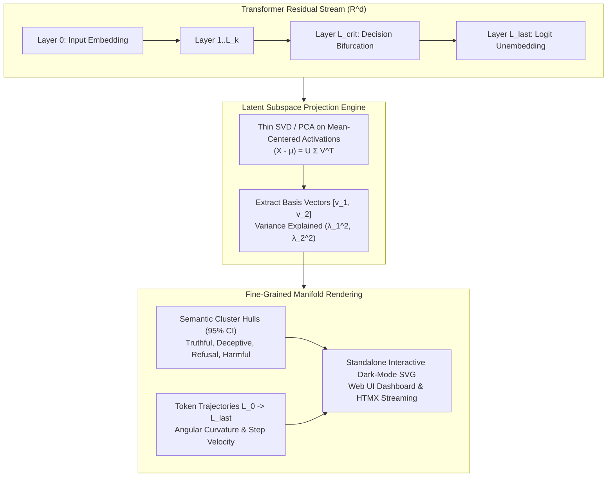
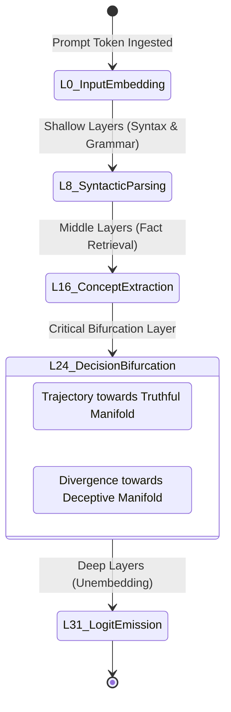
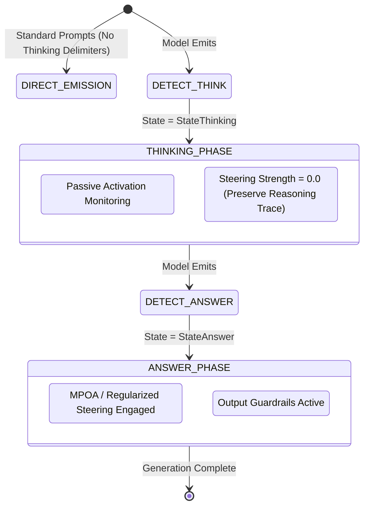
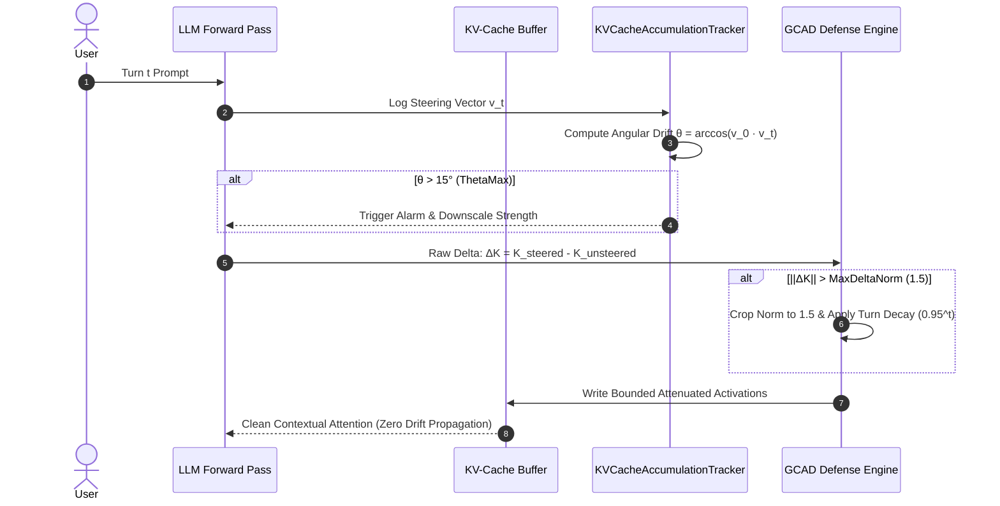

# Fine-Grained Semantic Latent Space Visualization & Manifold Analysis

> **Status**: Active Architecture Specification  
> **Module**: `internal/analysis/latent_vis.go`, `internal/web/`  
> **Version**: 0.7  

---

## 1. Executive Summary & Mathematical Foundation

In autoregressive transformer models, the residual stream $\mathbf{a}_l \in \mathbb{R}^d$ ($d \in [4096, 16384]$) functions as a continuous semantic latent highway. At each layer $l \in [0, L-1]$, multi-head self-attention and feed-forward MLP blocks read from and write back into this space.

BurnNotice introduces fine-grained 2D/3D visual representations of this high-dimensional semantic latent manifold. By projecting residual activations onto calibrated semantic subspaces and tracking token activation trajectories across layer depths, BurnNotice makes model internal representations, deceptive divergences, and steering interventions visually interpretable.

---

## 2. Orthogonal Subspace Projection

Given $N$ activation samples $\mathbf{a}_i \in \mathbb{R}^d$, the projection onto a 2D visualization manifold is computed either via data-driven Principal Component Analysis (thin SVD) or via pre-identified concept basis vectors:

### 2.1 Data-Driven SVD Projection
1. Compute activation centroid $\boldsymbol{\mu} = \frac{1}{N} \sum_{i=1}^N \mathbf{a}_i$.
2. Form the mean-centered matrix $\mathbf{X} \in \mathbb{R}^{N \times d}$ where $\mathbf{X}_{i,:} = \mathbf{a}_i - \boldsymbol{\mu}$.
3. Factorize $\mathbf{X}$ using thin Singular Value Decomposition:
   $$\mathbf{X} = \mathbf{U} \boldsymbol{\Sigma} \mathbf{V}^T$$
4. The first two columns of $\mathbf{V}$, $\mathbf{v}_1, \mathbf{v}_2 \in \mathbb{R}^d$, define the orthogonal projection subspace.
5. The projected 2D coordinates for activation $\mathbf{a}_i$ are:
   $$x_i = \mathbf{a}_i \cdot \mathbf{v}_1, \quad y_i = \mathbf{a}_i \cdot \mathbf{v}_2$$
6. The variance explained along each dimension is:
   $$\text{Var}_k = \frac{\sigma_k^2}{\sum_{j=1}^{\min(N, d)} \sigma_j^2}$$

### 2.2 Contrastive Basis Projection
When profiling specific target directions (e.g., Deception vs Truthfulness, or Refusal vs Compliance), $\mathbf{v}_1$ is defined as the unit-normalized difference-in-means direction $\mathbf{d}_{\text{target}}$, and $\mathbf{v}_2$ is obtained via Gram-Schmidt orthogonalization against the harmless prompt subspace.

---

## 3. Semantic Cluster Topology & Confidence Hulls

Projected points are classified into semantic categories:

| Category | Aesthetic Color | Hex | Semantic Meaning |
|:---|:---|:---|:---|
| **Truthful** | Emerald | `#10B981` | Factually accurate, aligned, verified answers |
| **Deceptive** | Crimson | `#EF4444` | Hallucinations, sycophancy, deceptive roleplay |
| **Refusal** | Amber | `#F59E0B` | Standard policy refusals, safety boundaries |
| **Creative** | Purple | `#8B5CF6` | Fictional writing, brainstorming, roleplay |
| **Harmful** | Rose | `#EC4899` | Malicious requests, cybercrime, CBRN threats |
| **Harmless** | Sky Blue | `#3B82F6` | General harmless informational queries |

For each category $c$, BurnNotice calculates:
- **Centroid**: $\mathbf{c}_c = \frac{1}{N_c} \sum_{i \in c} (x_i, y_i)$
- **Confidence Radii (95% CI)**: $r_{x, c} = 1.96 \cdot \sigma_{x, c}, \quad r_{y, c} = 1.96 \cdot \sigma_{y, c}$
- **Pairwise Geometric Separation**:
  $$S(c_1, c_2) = \frac{\|\mathbf{c}_{c_1} - \mathbf{c}_{c_2}\|_2}{\sqrt{\sigma_{c_1}^2 + \sigma_{c_2}^2}}$$

A degradation in $S(\text{Truthful}, \text{Deceptive}) > 25\%$ during steering triggers an alert (`LatentSeparationRatio`).

---

## 4. Token Trajectory Geometry & Curvature Analysis

Tracking a token's hidden state across all transformer layers ($L_0 \rightarrow L_{L-1}$) produces a directed path through latent space:

### 4.1 Trajectory Metrics
1. **Step Velocity**: Euclidean distance between adjacent layers:
   $$v_l = \sqrt{(x_{l+1} - x_l)^2 + (y_{l+1} - y_l)^2}$$
2. **Angular Curvature**: Deviation angle between consecutive layer transitions:
   $$\theta_l = \arccos\left(\frac{\Delta \mathbf{p}_l \cdot \Delta \mathbf{p}_{l-1}}{\|\Delta \mathbf{p}_l\|_2 \|\Delta \mathbf{p}_{l-1}\|_2}\right)$$
3. **Total Curvature**: $\kappa_{\text{total}} = \sum_{l=1}^{L-2} \theta_l$. High curvature indicates sharp behavioral shifts or compensating layer phenomena (Ouroboros effect).

---

## 5. Architectural Integrations

### 5.1 Reasoning Model Chain-of-Thought (CoT) State Machine
For reasoning architectures (DeepSeek-R1, QwQ), BurnNotice dynamically decouples monitoring from intervention based on `<think>` boundaries:

### 5.2 KV-Cache Steering Accumulation & GCAD Defense
To prevent multi-turn steering vectors from corrupting historical attention context:

---

## 6. Web Dashboard & API Endpoints

The BurnNotice Web UI exposes real-time latent space exploration:

- `GET /model/{id}/latent`: Interactive dashboard panel with category toggles, layer sliders, and analytics summaries.
- `GET /api/model/{id}/latent/svg`: Standalone high-resolution dark-mode vector SVG with `<filter id="glow">`, cluster ellipses, trajectory paths with direction arrows, and hover tooltips.
- `GET /api/model/{id}/latent/data`: JSON payload of projected points, cluster statistics, and trajectory curvature.
