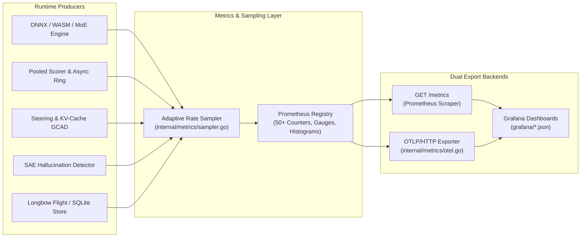

# BurnNotice: Observability Reference

> **Status**: Current
> **Date**: 2026-11-05
> **Version**: 0.8

---

## Overview

BurnNotice exposes two observability backends:

1. **Prometheus** - Pull-based metrics scraping via `/metrics` HTTP handler (50+ instruments)
2. **OpenTelemetry (OTel)** - Push-based metric export via OTLP/HTTP to any compatible collector

Both backends emit the same logical signals. Prometheus is enabled by default; OTel is opt-in via environment variables.



---

## Prometheus Metrics

### Endpoint

The `/metrics` endpoint is registered by `internal/metrics/handler.go` and served on the same port as the web dashboard (default `:8080`):

```bash
curl http://localhost:8080/metrics
```

### Inference Metrics

| Metric | Type | Labels | Description |
|---|---|---|---|
| `burnnotice_activations_processed_total` | Counter | `model_id`, `layer` | Total activations processed through the scoring pipeline |
| `burnnotice_onnx_forward_duration_seconds` | Histogram | `model_id` | ONNX Runtime forward pass latency |
| `burnnotice_wasm_forward_duration_seconds` | Histogram | `model_id` | WASM (wazero) forward pass latency |

### Scoring Metrics

| Metric | Type | Labels | Description |
|---|---|---|---|
| `burnnotice_scoring_duration_seconds` | Histogram | `model_id`, `direction` | Per-direction scoring latency (exponential buckets from 100µs) |
| `burnnotice_deception_score_current` | Gauge | `model_id`, `session_id` | Current deception risk score [0, 1] |
| `burnnotice_conflict_score_current` | Gauge | `model_id`, `session_id` | Current conflict intensity score [0, 1] |
| `burnnotice_truth_score_current` | Gauge | `model_id`, `session_id` | Current truth confidence score [0, 1] |
| `burnnotice_policy_compliance_current` | Gauge | `model_id`, `session_id` | Current policy compliance score [0, 1] |
| `burnnotice_whitening_detection_duration_seconds` | Histogram | `model_id` | Whitening-based policy detection latency |

### Steering & Policy Metrics

| Metric | Type | Labels | Description |
|---|---|---|---|
| `burnnotice_steering_interventions_total` | Counter | `model_id`, `method`, `layer` | Total steering interventions applied |
| `burnnotice_steering_dispatch_total` | Counter | `method` | Steering commands dispatched by method name |
| `burnnotice_alerts_total` | Counter | `model_id`, `metric`, `action` | Total alerts triggered across all thresholds |
| `burnnotice_kill_switch_triggers_total` | Counter | `model_id`, `reason` | Kill switch activations |
| `burnnotice_policy_violations_total` | Counter | `policy_name`, `metric`, `action` | Policy violations detected by rule |
| `burnnotice_lora_application_total` | Counter | `model_id`, `rank` | LoRA steering applications by rank |

### Profiling Metrics

| Metric | Type | Labels | Description |
|---|---|---|---|
| `burnnotice_profiling_batches_completed_total` | Counter | `model_id` | Contrastive batches processed during profiling |
| `burnnotice_profiling_job_duration_seconds` | Histogram | `model_id`, `status` | End-to-end profiling job duration (buckets: 1s–16384s) |
| `burnnotice_profile_jobs_total` | Counter | `status` | Profiling jobs by final status (`success`, `failed`, `cancelled`) |
| `burnnotice_profile_jobs_active` | Gauge | *(none)* | Currently running profiling jobs |
| `burnnotice_profile_count` | Gauge | *(none)* | Number of loaded model profiles |
| `burnnotice_dataset_pairs_loaded` | Gauge | `model_id`, `dataset_path` | Contrastive pairs loaded from the dataset file |
| `burnnotice_direction_extraction_duration_seconds` | Histogram | `method`, `model_id` | Direction extraction latency by method (DIM, PCA, SVD, INLP) |
| `burnnotice_profile_export_total` | Counter | `format` | Profile exports by format (`gob`, `json`) |
| `burnnotice_profile_import_total` | Counter | `format` | Profile imports by format |

### Longbow / Vector Store Metrics

| Metric | Type | Labels | Description |
|---|---|---|---|
| `burnnotice_longbow_ingest_duration_seconds` | Histogram | `operation` | Activation ingest latency (Longbow or SQLite backend) |
| `burnnotice_longbow_search_duration_seconds` | Histogram | `k` | Nearest-neighbour search latency by `k` |

### SAE (Sparse Autoencoder) Metrics

| Metric | Type | Labels | Description |
|---|---|---|---|
| `burnnotice_sae_feature_extraction_duration_seconds` | Histogram | `model_id`, `layer` | SAE feature extraction latency |
| `burnnotice_sae_reconstruction_error` | Histogram | `model_id` | L2 reconstruction error from the SAE |

### Hallucination Detection Metrics

| Metric | Type | Labels | Description |
|---|---|---|---|
| `burnnotice_hallucination_energy_current` | Gauge | `model_id`, `layer` | Current hallucination energy score |
| `burnnotice_hallucination_alerts_total` | Counter | `model_id`, `layer` | Total hallucination alerts triggered |

### Web Dashboard Metrics

| Metric | Type | Labels | Description |
|---|---|---|---|
| `burnnotice_active_sessions` | Gauge | *(none)* | Active monitoring sessions |
| `burnnotice_http_request_duration_seconds` | Histogram | `method`, `path`, `status` | HTTP handler latency |
| `burnnotice_sse_connections_active` | Gauge | *(none)* | Active SSE streaming connections |
| `burnnotice_sse_messages_sent_total` | Counter | *(none)* | Total SSE messages delivered to browsers |
| `burnnotice_dashboard_page_views_total` | Counter | `page` | Page-level view counts |

### Advanced / Research Metrics

| Metric | Type | Labels | Description |
|---|---|---|---|
| `burnnotice_cross_model_transfer_total` | Counter | `source_model`, `target_model`, `direction` | Cross-model direction transfers |
| `burnnotice_alignment_drift_alerts_total` | Counter | `direction`, `layer` | Alignment drift alerts from shadow profiling |
| `burnnotice_moe_expert_activation_total` | Counter | `model_id`, `expert_id`, `layer` | MoE expert activation counts |
| `burnnotice_cuda_kernel_latency_us` | Histogram | `kernel_name` | C++/CUDA GPU kernel latency in microseconds |
| `burnnotice_vllm_hook_triggers_total` | Counter | `model_id` | vLLM steering hook trigger counts |
| `burnnotice_llm_classifier_latency_ms` | Histogram | `classifier_type` | Async LLM pre-classifier latency in milliseconds |

---

## Grafana Dashboard

The `grafana/` directory ships pre-built dashboard JSON files for all metric categories. Import them via:

```bash
# Start the full stack (Prometheus + Grafana + BurnNotice)
docker compose up -d

# Or manually import in Grafana UI:
# Dashboards → Import → Upload JSON file
```

The Prometheus scrape target is configured in `docker-compose.yml` as:

```yaml
- targets: ['burnnotice:8080']
```

---

## OpenTelemetry (OTel) Export

BurnNotice supports OTLP/HTTP metric export via the `internal/metrics/otel.go` module. This is useful for pushing metrics to collectors like OpenTelemetry Collector, Grafana Tempo, or Honeycomb.

### Configuration (Environment Variables)

| Variable | Default | Description |
|---|---|---|
| `BURNNOTICE_OTEL_ENDPOINT` | *(empty - disabled)* | OTLP/HTTP collector endpoint (e.g., `http://otel-collector:4318`) |
| `BURNNOTICE_OTEL_INSECURE` | `false` | Set `true` to disable TLS verification |
| `BURNNOTICE_OTEL_EXPORT_INTERVAL` | `30s` | How often metrics are flushed to the collector |
| `OTEL_SERVICE_NAME` | `burnnotice` | Service name reported to the collector |

If `BURNNOTICE_OTEL_ENDPOINT` is empty, the OTel exporter is a no-op and no network connections are made.

### Initialization

OTel is initialized automatically in `cmd/burnnotice/main.go` using `OTelConfigFromEnv()`:

```go
cfg := metrics.OTelConfigFromEnv()
shutdown, err := metrics.InitOTelExporter(cfg)
if err != nil {
    log.Warn("OTel init failed", "err", err)
}
defer metrics.ShutdownOTel(ctx)
```

### Example: Export to OTel Collector

```bash
# Start an OTel collector on localhost:4318
export BURNNOTICE_OTEL_ENDPOINT=http://localhost:4318
export BURNNOTICE_OTEL_INSECURE=true
export OTEL_SERVICE_NAME=burnnotice-prod

./burnnotice profile ./onnx/model.onnx --dataset ./data/pairs.json
```

### OTel Resource Attributes

The exported resource is tagged with:

```
service.name = "burnnotice" (or $OTEL_SERVICE_NAME)
```

---

## Histogram Bucket Design

All latency histograms use exponential buckets tuned to their expected range:

| Category | First Bucket | Factor | Count | Range |
|---|---|---|---|---|
| Scoring, Longbow | 100µs | 2× | 12 | 100µs – 409ms |
| ONNX/WASM forward | 1ms | 2× | 12 | 1ms – 4096ms |
| Direction extraction | 10ms | 2× | 12 | 10ms – 40960ms |
| Profiling jobs | 1s | 2× | 15 | 1s – 32768s |
| CUDA kernels | 1µs | 2× | 12 | 1µs – 4096µs |
| LLM classifier | 10ms | 2× | 10 | 10ms – 10240ms |
