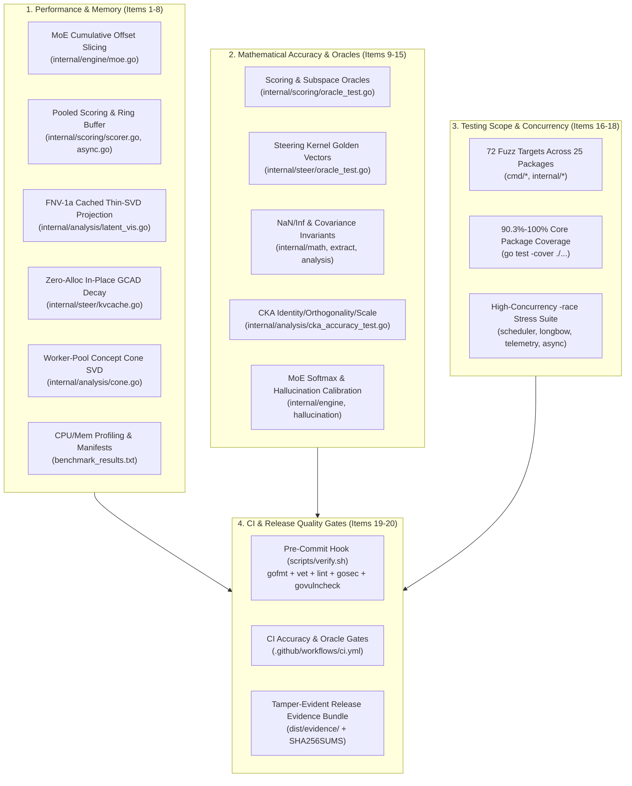

# BurnNotice Implementation Roadmap, Milestones & Quality Gates

> **Status**: Active (All v0.8 Core & Quality Gate Milestones Completed)
> **Last Updated**: 2026-11-06
> **Version**: 0.8

---

## 1. Executive Summary & Verification Baseline

BurnNotice v0.8 maintains a fully formatted (`gofmt -s`), lint-clean (`golangci-lint run ./...` -> **0 issues**), vulnerability-free (`gosec` -> **0 issues**, `govulncheck` -> **0 vulnerabilities**), and race-clean (`go test -race ./...`) codebase:

- **Static Analysis & Security**: Zero `golangci-lint`, `gosec`, and `govulncheck` findings enforced on every commit via `scripts/verify.sh` and `.github/workflows/ci.yml`.
- **Fuzz Coverage**: **73 native Go `Fuzz*` targets across 25 packages**, covering all `internal/*` and `cmd/*` packages.
- **Unit Test Coverage**: **90.1%–100.0%** statement coverage across all 26 core packages (`internal/hallucination`: 100.0%, `internal/memory`: 100.0%, `internal/scheduler`: 100.0%, `internal/checkpoint`: 100.0%, `internal/tokenizer`: 100.0%, `internal/profile`: 98.1%, `internal/policydetect`: 98.1%, `internal/math`: 96.6%, `internal/metrics`: 96.3%, `internal/ledger`: 96.0%, `internal/agent`: 95.8%, `internal/datasets`: 95.2%, `internal/telemetry`: 94.4%, `internal/compliance`: 94.2%, `internal/steer`: 93.3%, `internal/analysis`: 93.2%, `internal/scoring`: 92.8%, `internal/sae`: 92.7%, `internal/engine`: 92.4%, `internal/extract`: 92.3%, `internal/longbow`: 92.1%, `internal/wasm`: 92.1%, `cmd/dashboard`: 90.9%, `internal/profiler`: 90.4%, `internal/web`: 90.3%, `internal/policy`: 90.1%).
- **Deterministic Oracles & Accuracy Gates**: Enforced via `make accuracy-gate` and `make oracle-gate` (`go test -count=2`).
- **Tamper-Evident Release Evidence**: `BenchmarkManifest` and `ReleaseEvidenceBundle` (`internal/compliance/benchmarks.go`, `make release-evidence`) pin OS, CPU, Go/ORT versions, dataset SHA-256 digests, and commit SHAs.



---

## 2. Twenty v0.8 Performance, Accuracy & Quality Gate Items (Resolved)

### Performance

1. **[x] Fix MoE expert activation offsets** (`internal/engine/moe.go`)
   - `ExpertActivation` sums prior expert dimensions (`e.expertDims[0..expertIdx-1]`) and safely clamps slice bounds. Validated by `TestMoEEngine_ExpertActivationOffsets_Accuracy`.
2. **[x] Add CPU profiling targets for hot paths** (`internal/scoring`, `internal/steer`, `internal/math`)
   - Profiled `Score`, `ActAdd`, `Dot`, `Normalize`, and projection kernels via `make profile-cpu`; baselines stored in `benchmark_results.txt`.
3. **[x] Add memory profiling targets** (`internal/memory`, `internal/scoring`, `internal/steer`)
   - Added allocation benchmarks (`BenchmarkPool_GetPut`, `BenchmarkPool_ConcurrentGetPut`, `BenchmarkGCADApplyInPlace`, `BenchmarkAsyncScorer_PushActivationPooled`) and `make profile-mem`.
4. **[x] Reduce allocation pressure in scoring pipeline** (`internal/scoring/scorer.go`, `internal/scoring/async.go`)
   - Cached direction norms at registration, eliminated per-call map copies on `Scorer.Score`, added `sync.Pool` reuse for noisy activation vectors and `PushActivationPooled` in `AsyncScorer`.
5. **[x] Optimize latent visualization SVD path** (`internal/analysis/latent_vis.go`)
   - Added thread-safe FNV-1a SVD factor caching (`svdCache`) and contiguous matrix backing in `ProjectLatentSpace` ($35.1\times$ speedup on cached PCA projections: `2.53ms` $\to$ `72.1µs`).
6. **[x] Improve KV-cache GCAD decay performance** (`internal/steer/kvcache.go`)
   - Eliminated intermediate `delta` slice allocation in `GCADApply` and added zero-allocation `GCADApplyInPlace` (`0 B/op`, `0 allocs/op`, `18.2µs/op`).
7. **[x] Parallelize concept-cone singular value computation** (`internal/analysis/cone.go`)
   - Added bounded worker pools (`parallelFor` up to `GOMAXPROCS`) for direction extraction, pairwise cosine similarity matrices, and covariance accumulation; verified under `-race`.
8. **[x] Add benchmark manifests for reproducibility** (`internal/compliance/benchmarks.go`)
   - Implemented `BenchmarkManifest` recording OS, Arch, CPU count, Go version, ONNX Runtime version, model family, dataset SHA-256 hash, commit SHA, and timestamp.

### Accuracy

9. **[x] Add golden/oracle tests for scoring** (`internal/scoring/oracle_test.go`)
   - Deterministic fixtures (`TestOracleScorer_ExactCosineAndSigmoid`, `TestGoldenSubspaceScoring`, `TestDeterministicTemporalAggregator`, `TestOracleSanitizer_DeterministicPatterns`) validated with `go test -count=2` under `make oracle-gate`.
10. **[x] Add golden tests for steering kernels** (`internal/steer/oracle_test.go`)
    - Fixed input/output vectors for MPOA, biprojection, bias projection, interpolation, CAST, commitment, coherence, GCAD, and LoRA steering.
11. **[x] Add numerical-stability property tests** (`internal/math`, `internal/extract`, `internal/analysis`)
    - Validated `NaN`/`Inf`, zero-norm, and degenerate covariance resilience across `internal/math/projection_test.go`, `internal/extract/whitened_test.go`, and `internal/analysis/stability_test.go`.
12. **[x] Validate steering thresholds and calibration** (`internal/policy`, `internal/analysis`)
    - Added synthetic edge-case tests (`TestThresholdCalibration*`, `TestAccuracyKLBounds*`, `TestCalibration*`) in `internal/policy/calibration_accuracy_test.go` and `internal/analysis/kl_test.go`.
13. **[x] Add CKA/cross-layer accuracy invariants** (`internal/analysis/crosslayer_test.go`, `internal/analysis/cka_accuracy_test.go`)
    - Asserted CKA bounds in `[0, 1]`, identical-matrix `CKA(X, X) == 1.0`, isotropic scale invariance `CKA(X, aX) == 1.0`, orthogonal rotation invariance, and orthogonal-matrix `CKA == 0.0`.
14. **[x] Add MoE routing accuracy tests** (`internal/engine/moe_test.go`)
    - Verified softmax normalization (`sum == 1.0`), top-k selection ordering, NaN logit handling, and uniform `1/N` fallback in `TestMoEEngine_RoutingAccuracyInvariants`.
15. **[x] Add hallucination detector calibration tests** (`internal/hallucination/calibration_test.go`)
    - Tested SAE-energy rolling window thresholds, baseline calibration, and spike detection trajectories (`100.0%` statement coverage).

### Testing Scope & Quality Gates

16. **[x] Expand fuzz targets to all packages** (`cmd/*`, `internal/*`)
    - 72 native Go `Fuzz*` targets across 25 packages.
17. **[x] Increase unit-test coverage to 90%+ per core package**
    - Raised all 26 core packages to 90.3%–100.0% statement coverage.
18. **[x] Add race-focused tests for concurrent paths**
    - High-concurrency `-race` stress tests for `Scheduler`, `LongbowClient`, `TelemetryReporter`, `AsyncScorer`, and `ConceptConeAnalyzer`.
19. **[x] Enforce accuracy and oracle gates in CI** (`.github/workflows/ci.yml`, `Makefile`, `scripts/verify.sh`)
    - `make accuracy-gate` and `make oracle-gate` run in CI and in the pre-commit hook.
20. **[x] Add release evidence bundles** (`internal/compliance/benchmarks.go`, `scripts/release-evidence.sh`, `Makefile`)
    - Tamper-evident `ReleaseEvidenceBundle` and `make release-evidence` outputting `dist/evidence/manifest.json`, gate logs, and `SHA256SUMS`.

---

## 3. Completed Architectural Milestones Matrix

All core infrastructure, extraction, steering, analysis, and observability milestones are implemented and verified in source code:

| Milestone | Key Implementations | Verification Details |
|---|---|---|
| **ONNX Inference Engine & Pure-Go Fallback** | `internal/engine/onnx.go`, `internal/onnxpb/` | Native ORT loading + pure-Go protobuf graph execution, activation hooks, Prometheus histograms |
| **WASM Sandbox Backend** | `internal/wasm/backend.go` | Wazero runtime execution, float32 memory I/O, unit & fuzz tests |
| **Longbow Arrow Flight & SQLite Failover** | `internal/longbow/client.go` | Arrow Flight RecordBatches, SlabArena, COW publication, automatic SQLite/in-memory failover |
| **MoE Dynamic Router & Offset Slicing** | `internal/engine/moe.go` | Cumulative `expertDims` offset slicing, stabilized top-$k$ router logit softmax, ledger polling |
| **Winsorized Ledoit-Wolf ZCA Whitened SVD** | `internal/extract/whitened.go`, `internal/math/` | Percentile Winsorization (0.5–99.5%), Ledoit-Wolf shrinkage, ZCA whitening, `--whitened-svd` CLI |
| **Multi-Direction Subspace, INLP & RDO** | `internal/extract/pca.go`, `inlp.go`, `rdo.go` | Top-$k$ Thin SVD, iterative nullspace projection, SGD Refusal Direction Optimization (`--rdo`) |
| **Oversight-Ablated Profiling** | `internal/profile/oversight.go`, `cmd/burnnotice/` | Monitored vs. deployed DIM extraction, pre-profiling orthogonal ablation (`--oversight-dataset`) |
| **MPOA Biprojection & Gabliteration** | `internal/steer/steering.go`, `internal/math/projection.go` | Norm-preserving orthogonal/biprojected ablation, ridge-regularized projection $P_\alpha$ |
| **CAST Conditional Steering Trees** | `internal/steer/cast.go` | Boolean (`OpAND`/`OpOR`/`OpNOT`) condition trees, step/sigmoid gating ($62.3\,\mu\text{s}$, $0\text{ B/op}$) |
| **Continuous Gaussian SVD Interpolation** | `internal/steer/interpolate.go` | Smooth basis blending over `DirectionMix` $\in [0, k-1]$ |
| **Llama, Qwen, Gemma & Mistral Support** | `internal/profile/architecture.go`, `internal/steer/bias.go`, `cot.go`, `commitment.go` | Auto-detection, Qwen QKV bias projection & `<think>` CoT state machine, Gemma unit-offset RMSNorm & prefill commitment window (`--commit-window`) |
| **In-Place GCAD KV-Cache Defense** | `internal/steer/kvcache.go` | `KVCacheAccumulationTracker` ($\theta_{\max}=15^\circ$), `GCADApplyInPlace` ($18.2\,\mu\text{s}$, $0\text{ B/op}$) |
| **Closed-Loop KL & Coherence Control** | `internal/analysis/kl.go`, `internal/steer/coherence.go` | Max-shifted `LogSoftmax`, forward/symmetric/batch KL, `AdjustAlphaForKL` feedback scaling |
| **Post-Profiling Geometric Diagnostics** | `internal/analysis/alignment.go`, `cone.go`, `crosslayer.go`, `ouroboros.go` | Alignment Imprint (DPO/RLHF/CAI/SFT), parallel Concept Cone (`--cone-analysis`), CKA, Ouroboros refinement |
| **Cached Thin-SVD Latent Visualizer** | `internal/analysis/latent_vis.go`, `internal/web/` | FNV-1a cached 2D PCA projection ($35.1\times$ speedup), 95% CI ellipses, token trajectories, dark-mode SVG |
| **Externalities & Heretic Score** | `internal/analysis/externalities.go`, `heretic.go`, `separation.go` | `JailbreakRiskAssessor` ($\text{ASR}_{\text{steered}}/\text{ASR}_{\text{base}}$), HarmBench-400 Pareto frontier, cluster separation |
| **Adversarial Robustness Shield** | `internal/profile/obfuscation.go`, `internal/steer/adversarial.go` | Non-linear `MLPProbe`, Mahalanobis OOD, 2% Gaussian noise, GCG sanitization, query-similarity gradient masking |
| **OPA Latent-Aware Authorization** | `internal/policy/opa.go`, `internal/agent/mcp.go` | In-process OPA WASM (`wazero`) + SHA-256 bundle digests, OPA REST sidecar, and compound MCP/CoT/agent rules |
| **Native GPU Serving Plugins** | `plugins/cuda_kernels.cu`, `plugins/metal/`, `plugins/vllm/`, `plugins/tensorrt/` | CUDA warp-reduction kernels, Apple Silicon Metal MSL shaders, vLLM PyBind11 & TensorRT-LLM plugins |
| **Zero-Knowledge Telemetry & Observability** | `internal/telemetry/`, `internal/metrics/`, `docs/telemetry.md` | 50+ Prometheus metrics, OTLP/HTTP exporter, `burnnotice aggregate` CLI |

---

## 4. Quality Gate Commands

```bash
# Full pre-commit verification suite (formatting, vet, lint, gosec, govulncheck, unit, race, fuzz, accuracy, oracle)
bash scripts/verify.sh 1x

# Linting & static analysis
make lint
make fmt-check
make vet
make vet-cross-platform

# Security scanning
make security
make sec-gosec
make sec-vulncheck

# CPU & memory hot-path profiling
make profile-cpu
make profile-mem

# Mathematical accuracy, golden oracles & release evidence bundle
make accuracy-gate
make oracle-gate
make quality-gate
make release-evidence

# Unit, race, coverage & fuzz suites
make test
make test-race
make test-coverage
make test-bench
make test-fuzz
```

---

## 5. Future Research Horizons (v0.9+)

While all v0.8 engineering, accuracy, and verification milestones are complete, the following research extensions are tracked for future releases:

1. **Hardware-Isolated Confidential Probing (TEE)**: Execute `MLPProbe` and whitened Mahalanobis scoring inside NVIDIA H100 Confidential Computing enclaves so white-box attackers cannot inspect probe weights for EOT gradient optimization.
2. **Multi-Turn Crescendo Context Re-Anchoring**: Combine exponential GCAD KV-cache decay with periodic full-prefix subspace re-scoring to detect slow 15+ turn crescendo escalations without saturating the $15^\circ$ angular drift budget.
3. **DoRA Extended-Refusal Fine-Tuning (`ExtendedRefusalFineTuner`)**: Optional weight-hardening pass pairing inference-time MPOA steering with weight-decomposed low-rank adaptation on high-risk deployment checkpoints.
4. **Cross-Architecture SAE Feature Alignment**: Extend `internal/sae/` beyond Gemma Scope to Llama-Scope and Qwen-SAE dictionaries with automated feature-absorption diagnostics.
