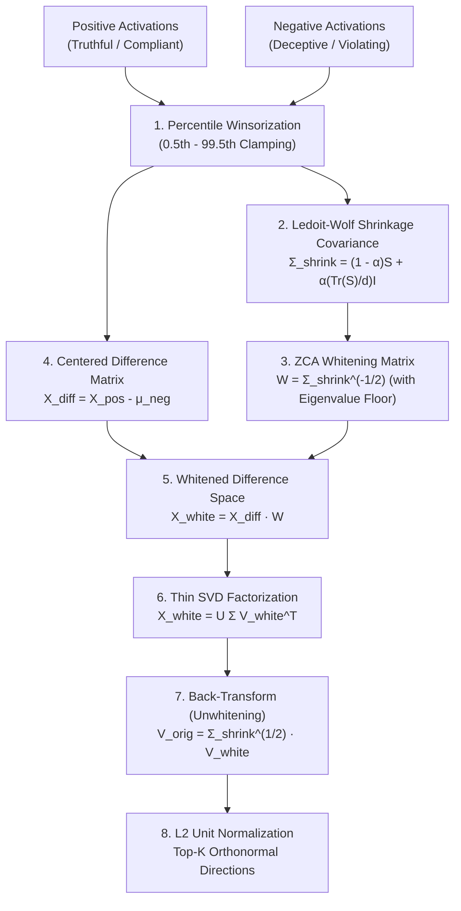

# Whitened SVD Extraction

> **Status**: Current
> **Last Updated**: 2026-11-05
> **Version**: 0.8

BurnNotice implements a robust method for extracting deception and behavioral directions using **Whitened Singular Value Decomposition (SVD)**. This method identifies the most significant directions of variance distinguishing positive (e.g., truthful) from negative (e.g., deceptive) activations. 

Standard Difference-in-Means (DIM) or raw SVD can sometimes be dominated by high-variance components of the residual stream that are not necessarily semantic. By applying a whitening transformation first, we normalize the variance in all directions, allowing SVD to find the true underlying discriminative subspace.



## Process Overview

1. **Activation Collection**: We collect $N$ positive and $N$ negative activation vectors from the model.
2. **Winsorization**: The activations are winsorized at the 0.5th and 99.5th percentiles to mitigate the impact of extreme outliers.
3. **Covariance Estimation**: We estimate the covariance matrix $\Sigma$ of all combined activations. Because $N$ is often smaller than the hidden dimension $d$, we use the **Ledoit-Wolf Shrinkage** estimator to ensure the covariance matrix is well-conditioned and invertible.
4. **ZCA Whitening Transform**: We compute the whitening matrix $W = \Sigma^{-1/2}$ via eigenvalue decomposition.
5. **Whitening the Difference**: We compute the centered difference matrix $X_{diff}$ (positive activations minus the mean of the negative activations) and whiten it: $X_{white} = X_{diff} W$.
6. **SVD**: We perform Thin SVD on $X_{white}$ to extract the top $k$ principal directions, $V_{white}$.
7. **Unwhitening**: We transform the directions back into the original activation space by multiplying by $\Sigma^{1/2}$: $V_{orig} = \Sigma^{1/2} V_{white}$.
8. **Normalization**: Finally, the extracted directions are L2-normalized.

## Covariance Estimation & Ledoit-Wolf Shrinkage

When dealing with large language models, the hidden dimension $d$ (e.g., 4096) is often larger than the number of prompt pairs $N$ (e.g., 500-1000). The standard empirical covariance matrix is rank-deficient and cannot be inverted for whitening.

BurnNotice uses the **Ledoit-Wolf Shrinkage Estimator** to regularize the covariance matrix:

$\Sigma_{shrink} = (1 - \alpha) S + \alpha \left( \frac{\text{Tr}(S)}{d} \right) I$

Where $S$ is the empirical covariance matrix, and $\alpha \in [0, 1]$ is the shrinkage intensity. 

If $\alpha < 0.0$ is provided, BurnNotice dynamically calculates the optimal Ledoit-Wolf shrinkage intensity $\alpha$ that minimizes the mean squared error between the estimated and the true covariance matrix.

## Usage

You can use the whitened SVD extraction method in the BurnNotice CLI by passing the `--whitened-svd` flag during profiling:

```bash
burnnotice profile ./onnx/qwen2.5-0.5b/model.onnx --dataset ./data/deception_pairs.json --whitened-svd
```

When this flag is active, BurnNotice will extract the top 5 principal directions ($k=5$) using a dynamically computed Ledoit-Wolf optimal $\alpha$, and it will select the primary direction as the main deception direction.
