# BurnNotice Test Suite, Quality Gates & Security Reference

BurnNotice employs a rigorous testing suite, deterministic oracle gates, property-based accuracy invariants, fuzzing across all packages, and static analysis to ensure mathematical precision, thread safety, and zero security vulnerabilities.

---

## 1. Testing Strategy

The test suite prioritizes 90%+ statement coverage across core packages, deterministic golden/oracle verification (`-count=2`), numerical-stability invariants (`NaN`/`Inf`/degenerate covariance), and offline validation of external formats (ONNX models, Safetensors, and Gemma Scope NPZ archives).

```mermaid
flowchart LR
    subgraph Static["Static & Security Gates"]
        FMT["gofmt -s -l ."]
        VET["go vet ./...\n+ Cross-Platform Vet"]
        LINT["golangci-lint\n(0 issues)"]
        SEC["gosec + govulncheck\n(0 vulnerabilities)"]
    end

    subgraph Dynamic["Unit, Race & Fuzz Matrix"]
        UNIT["Unit Suite\n(90%-100% Core Coverage)"]
        RACE["Concurrent Race Detector\n(go test -race ./...)"]
        FUZZ["72 Native Fuzz Targets\n(25 Packages)"]
    end

    subgraph Invariants["Mathematical & Release Gates"]
        ACC["make accuracy-gate\n(CKA, KL, Calibration, Stability)"]
        ORA["make oracle-gate\n(-count=2 Golden Fixtures)"]
        EVID["make release-evidence\n(Manifest + SHA256SUMS)"]
    end

    FMT --> VET --> LINT --> SEC --> UNIT --> RACE --> FUZZ --> ACC --> ORA --> EVID
```



### Programmatically Generated Mock Objects
To allow fully offline and lightweight testing without massive model files, the test suite generates minimal, mathematically valid mock inputs:
1. **Dynamic ONNX Models**: Built programmatically using `google.golang.org/protobuf` and `onnxpb`, with both native ORT execution and a pure-Go ONNX protobuf graph interpreter fallback (`internal/engine/onnx.go`).
2. **NumPy v1/v2 NPY Arrays**: Generates raw byte buffers with Python-style dictionary descriptors (`shape`, `descr`, `fortran_order`) to validate the SAE parser.
3. **NPZ Zip Archives**: Packages mock `.npy` files inside a zip writer to test `LoadGemmaScope` without external binary assets.

---

## 2. Package Coverage Summary

All core packages meet or exceed the 90% statement coverage target:

| Package | Coverage | Key Verified Invariants & Paths |
|---|---|---|
| `internal/agent` | **98.9%** | LangChain/CrewAI/MCP middleware interception, multi-agent governor, SDK hooks |
| `internal/analysis` | **93.2%** | Cached Thin SVD latent projection, worker-pool ConceptCone, CKA invariants, KL bounds, Ouroboros |
| `internal/checkpoint` | **100.0%** | Atomic checkpoint save/load and corruption recovery |
| `internal/compliance` | **94.2%** | Approval workflows, PDF compliance reports, `BenchmarkManifest`, `ReleaseEvidenceBundle` |
| `internal/datasets` | **95.2%** | Contrastive dataset loading and validation |
| `internal/engine` | **92.4%** | Multi-expert MoE offset extraction, softmax top-k routing, ONNX session & pure-Go fallback |
| `internal/engine/native` | **100.0%** | SIMD/CGO kernel dispatch and fallbacks |
| `internal/extract` | **92.3%** | DIM, PCA, RDO, INLP, whitened SVD, cross-layer transfer, NaN/Inf resilience |
| `internal/hallucination` | **100.0%** | SAE-energy rolling window calibration, spike detection trajectories, risk thresholds |
| `internal/ledger` | **96.0%** | SQLite WAL & Longbow alert persistence and querying |
| `internal/longbow` | **92.1%** | Arrow Flight vector client, automatic SQLite/in-memory fallback, concurrent race safety |
| `internal/math` | **96.6%** | Winsorization, Bessel/Ledoit-Wolf shrinkage covariance, ZCA whitening, ridge projection |
| `internal/memory` | **100.0%** | Pooled activation buffer reuse and capacity bounds |
| `internal/metrics` | **96.3%** | Prometheus `/metrics` handler, OTel exporter configuration, adaptive sampler |
| `internal/policy` | **90.1%** | Policy evaluation engine, OPA WASM/HTTP/compound evaluator (`OPAEvaluator`), dynamic drift threshold calibration, semantic gater, killswitch |
| `internal/policydetect` | **98.1%** | Whitened Mahalanobis policy violation detection |
| `internal/profile` | **98.1%** | Architecture auto-detection, threshold calibration, drift detection, version manager |
| `internal/profiler` | **90.4%** | Progressive and distributed activation profiling |
| `internal/sae` | **92.7%** | Gemma Scope NPZ/NPY loader, Top-K sparse autoencoder encode/decode |
| `internal/scheduler` | **100.0%** | Priority job preemption and concurrent worker scheduling |
| `internal/scoring` | **92.8%** | Zero-copy direction scoring, pooled async ring-buffer bypass, temporal aggregation, oracle fixtures |
| `internal/steer` | **93.3%** | MPOA, biprojection, CAST, in-place GCAD KV-cache decay, LoRA rank-1 updates, coherence |
| `internal/telemetry` | **94.4%** | Batched telemetry aggregation, retry/fallback storage, concurrent race safety |
| `internal/tokenizer` | **100.0%** | Word-hash and byte-level tokenizers |
| `internal/wasm` | **92.1%** | Wazero WebAssembly sandbox execution and float32 tensor marshaling |
| `internal/web` | **90.3%** | Dashboard HTTP handlers, SSE streaming, SVG manifold rendering |
| `cmd/dashboard` | **90.9%** | Dashboard server lifecycle and routing |

---

## 3. Fuzz Testing (73 Targets Across 25 Packages)

Every package in `internal/` and `cmd/` includes native Go `Fuzz*` targets runnable via `make test-fuzz`:

| Package | Fuzz Targets |
|---|---|
| `cmd/burnnotice` | `FuzzParseModelSize` |
| `cmd/dashboard` | `FuzzDashboardHandler` |
| `internal/agent` | `FuzzMiddlewareInterceptAndBlock`, `FuzzMultiAgentGovernor` |
| `internal/analysis` | `FuzzProjectLatentSpace`, `FuzzConceptConeAnalyzer`, `FuzzKL`, `FuzzCKA`, `FuzzAlignmentImprintDetector` |
| `internal/converter` | `FuzzParseSafetensors`, `FuzzGetTensorElementSize`, `FuzzTensorElementCount`, `FuzzParseHeader`, `FuzzFindSafetensorsFiles`, `FuzzReadUint64LE`, `FuzzONNXConverter` |
| `internal/engine` | `FuzzMoEDetectRouting` |
| `internal/extract` | `FuzzExtractDIM`, `FuzzNormalize`, `FuzzSigmoid`, `FuzzDot`, `FuzzExtractWhitenedSVD` |
| `internal/hallucination` | `FuzzComputeEnergy`, `FuzzRiskScoreAndThreshold`, `FuzzDetectSpikeRollingWindow` |
| `internal/ledger` | `FuzzSerializeDeserializeAlert`, `FuzzLongbowBackendQuery` |
| `internal/longbow` | `FuzzSerializeDeserializeFloats`, `FuzzFallbackSearchAndMath` |
| `internal/math` | `FuzzCovariance`, `FuzzShrinkageCovariance`, `FuzzWinsorize`, `FuzzWinsorizeInPlace`, `FuzzIsStable`, `FuzzClampToFloat64`, `FuzzWhiteningMatrix`, `FuzzApplyWhitening` |
| `internal/memory` | `FuzzPoolGetPut` |
| `internal/metrics` | `FuzzAdaptiveSampler`, `FuzzAdaptiveSamplerSetRate`, `FuzzDefaultSampler`, `FuzzMetricsHandler`, `FuzzOTelConfigFromEnv` |
| `internal/onnxpb` | `FuzzModelProtoUnmarshal` |
| `internal/policy` | `FuzzSemanticGater_ClassifyPrompt`, `FuzzOPAEvaluator` |
| `internal/profile` | `FuzzDetectModelFamilyAndPrompt`, `FuzzImportProfileAndDrift` |
| `internal/profiler` | `FuzzProgressiveProfiler`, `FuzzDistributedProfiler` |
| `internal/registry` | `FuzzRegistryAddListFilter` |
| `internal/sae` | `FuzzSAEEncodeDecodeTopK`, `FuzzNpyHeaderParser` |
| `internal/scheduler` | `FuzzSchedulerSubmitAndPreempt` |
| `internal/scoring` | `FuzzScorer_Score`, `FuzzScorer_Subspace` |
| `internal/steer` | `FuzzActAdd`, `FuzzAngular`, `FuzzAblate`, `FuzzDispatcher` |
| `internal/telemetry` | `FuzzTelemetryAggregateAndSubmit` |
| `internal/tokenizer` | `FuzzWordHashTokenizer`, `FuzzByteTokenizer` |
| `internal/wasm` | `FuzzEncodeDecodeF32` |
| `internal/web` | `FuzzHandlersAndSSE` |
| `internal/zjson` | `FuzzUnmarshal`, `FuzzMarshal`, `FuzzParse`, `FuzzTokenizer`, `FuzzUnescape`, `FuzzDecodeStream`, `FuzzGetBytes`, `FuzzAppendJSON` |

---

## 4. Accuracy, Oracle & Profiling Quality Gates

```bash
# Run mathematical accuracy, CKA, KL, calibration, and numerical-stability invariants
make accuracy-gate

# Run deterministic golden/oracle fixtures twice (-count=2) to detect any drift
make oracle-gate

# Run CPU and memory allocation profiling on hot paths (saves baselines to benchmark_results.txt)
make profile-cpu
make profile-mem

# Generate tamper-evident release evidence bundle in dist/evidence/
make release-evidence
```

---

## 5. Static Analysis & Security Auditing

BurnNotice enforces zero lint and security findings across the entire repository:
- `make fmt-check` (`gofmt -l .`)
- `make vet` & `make vet-cross-platform`
- `make lint` (`golangci-lint run ./...` -> **0 issues**)
- `make sec-gosec` (`gosec ./...` -> **0 issues**)
- `make sec-vulncheck` (`govulncheck ./...` -> **0 vulnerabilities**)
